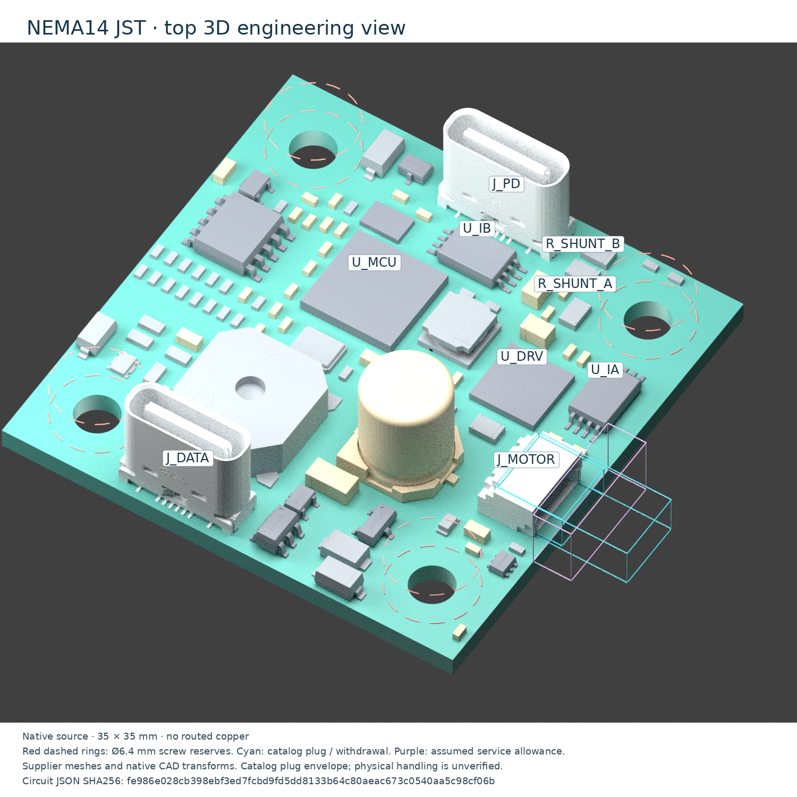
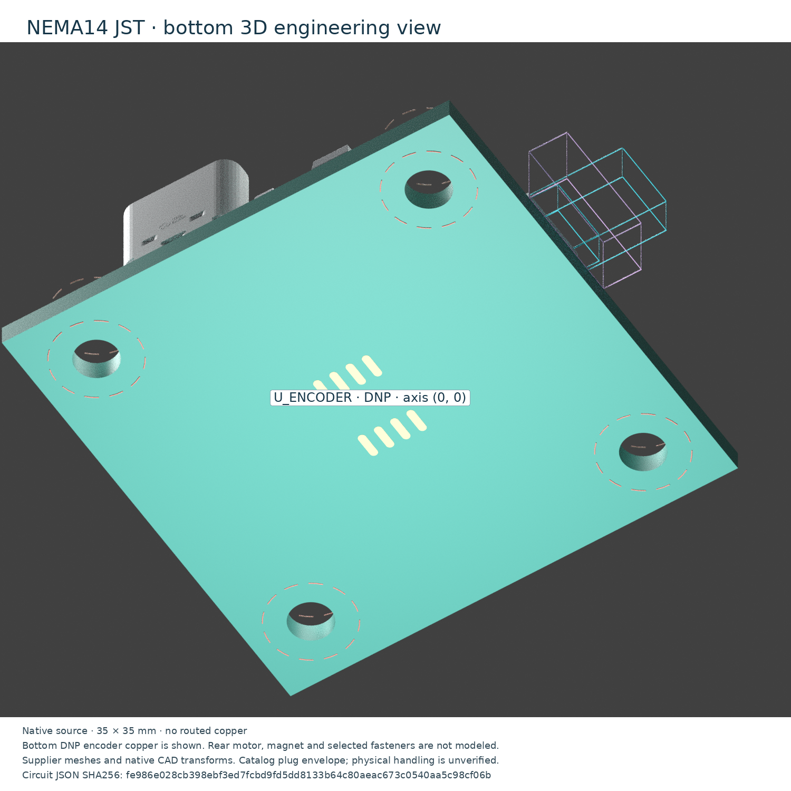

# NEMA14 JST

This isolated engineering study adds two inline 50 mΩ winding shunts and two INA240A1PW current-sense channels to RP2040 GPIO26/27, keeps the optional DNP encoder on the bottom at (0, 0), moves its DNP capacitors to the top, and uses a side-facing SM04B-SRSS-TB header. The original board entry point and saved boards at the repository root remain unchanged.

**Layout status: mechanically clear placement study; routing blocked by electrical locality.** There is no completed routed board or manufacturing release here.

| Check | Result |
| --- | --- |
| Outline / layers / board thickness | 35 × 35 mm / 4 / 1.6 mm |
| Mount geometry | Four Ø3.2 mm holes at (±13, ±13) |
| Screw reserves | All four radius 3.2 mm reserves enabled on every copper layer and for placement |
| USB poses | Original native positions, rotations and layers preserved |
| Population | 101 top component courtyards; optional DNP encoder remains bottom |
| Native placement DRC and independent screw screen | Pass on the current native source |
| Electrical source contract | Both independent channels, PW pinout, filters, ADC mapping, winding order and DNP policy pass |
| Electrical locality | 25 / 59 engineering placement targets pass; 34 fail (baseline: 19 / 59) |
| Routed copper | 0 traces, 0 vias; power loops and physical Kelvin pickup unverified |
| Plug clearance | Conservative catalog housing, withdrawal and service envelopes pass the supplier-solid screen |

The current bounded iteration retains every baseline passing target and does not worsen any P0 driver, Kelvin, INA bypass or buck separation. It improves six locality targets; 34 still fail. Both pin-2 star returns are now explicit checks: one screened path is about 3.4 mm, the other remains about 12.8 mm against a 5 mm engineering target. The source contains no routed copper. Isolated native routing subsets are diagnostics and do not qualify this board.

The earlier top-side search moved the MCU, motor driver, power supply, amplifiers, passives and test pads rather than moving the encoder or changing the mechanical outline. Constraint-based and constructive searches were tried. A complete top-side placement clears the courtyards and screw reserves, but its bypassing, ADC filters, oscillator and power-stage locality are still inadequate under the documented targets. Some stricter searches exhausted their time budgets; this does not prove that a suitable top-side layout is impossible or that bottom-side parts are required. The targets in [locality-contract.json](scripts/locality-contract.json) are conservative engineering screens, not manufacturer absolute limits or routed-length signoff.

[Electrical priorities and bounded iteration](docs/locality-iteration.md) · [Measured before/after report](artifacts/iteration-1/report.json) · [Planned star-return corridors](review/critical-corridors.svg)

[Top PCB](review/top.svg) · [Bottom PCB](review/bottom.svg) · [Native Circuit JSON](artifacts/final-source.circuit.json)





## Reproduce

Use Bun 1.4.2, the committed `bun.lock`, Python 3.12 and the pinned dependencies. From this directory:

```sh
bun install --frozen-lockfile
npm run typecheck
npm run test:gate
npm run test:plug
python3 -m pip install -r requirements-geometry.txt
npm run test:copper
npm run source:check
npm run check:electrical
npm run check:placement
npm run check:locality
npm run check:plug
```

`source:check` runs the native entry point, `tsci build controller.tsx --routing-disabled`, with CLI 0.1.2261 and tscircuit 0.0.2764. Native DRC is enabled. The parts metadata engine is disabled because supplier footprints and CAD are imported locally; this does not suppress placement or routing errors. `check:locality` intentionally returns nonzero for the current source. Install `requirements-geometry.txt` for the independent geometry and critical-path checks; `npm run test:copper` runs eleven connectivity/Kelvin regressions. Run `npm run check:critical-placement` separately to see the explicit star-return reservation gate. `npm run check:independent` correctly reports the current 70 disconnected PCB nets, since no copper has been installed. Run `check:plug` separately to reproduce its independent report; its Python solid check needs CadQuery.

`npm run autoroute` first runs the complete source/electrical/mechanical/locality/plug gate and only starts native routing if they all pass. Its current nonzero locality gate is intentional. The command also requires the new star-return preflight, and independent physical connectivity plus routed Kelvin/return/USB-reference checks after any native routed output. Do not bypass it to produce a convincing-looking routed preview. A passing placement build does not qualify a routed board. The native single-sheet schematic still reports drawing-area warnings; schematic presentation also needs review. The CI job covers native source generation, electrical contracts, placement, regressions and the locality gate. The locality step is expected to fail while this draft retains the documented placement failures; it is deliberately not suppressed.

To regenerate the review views after a successful native placement build:

```sh
npm run review:pcb
bun scripts/describe-plug.ts artifacts/final-source.circuit.json artifacts/side-entry-plug.json
python3 scripts/render-review-3d.py
```

The 3D script uses Blender 4.3.2, CadQuery, NumPy and Pillow and renders the actual supplier OBJ meshes with native CAD transforms. It shows the DNP encoder's bottom copper, not an assembled encoder. The board outline and four mounting holes are generated from the native Circuit JSON.

## Plug and physical limits

The plug screen uses the [JST SH catalog](https://www.jst-mfg.com/product/pdf/eng/eSH.pdf): SHR-04V-S without protrusions, a 6.25 mm mated assembly depth and 2.95 mm mated height. It assumes a 0.15 mm envelope allowance, a 5 mm straight withdrawal, and a 2 mm lateral/vertical service allowance on the exposed housing. These are engineering screens. The housing extends only about 0.96 mm past the PCB edge. Wire bend radius, grip force, real cable release, tolerance stack, rear motor clearance, selected fasteners, magnet alignment, thermal performance, ADC noise and bench operation are unverified.

[Plug report](artifacts/plug-clearance.json) checks 91 fitted supplier solids and the four screw reserve cylinders. The two USB STEP shapes are invalid solids, so their complete supplier bounds are used conservatively. All 92 fitted supplier bodies, including the header, also clear the four screw XY projections; the report records the supplemental header check. This does not select or qualify physical fasteners. The catalog plug envelope is not a detailed supplier plug solid. Do not interpret this report as physical mating or service qualification.

## Source provenance and preservation

The study starts from public repository commit `b9864ad90458cb3bb6f996090dcd7ac4aeb0db5c`. [Asset provenance](artifacts/public-asset-provenance.json) records the byte hashes and reuses existing root CAD whenever identical; the four added INA240/header assets come from the supplier imports recorded by the catalog. Supplier land patterns and CAD are not shrunk to make the study fit. No private repository source or private discussion is included. The NEMA14 WAGO design is outside this study.

The screw regression fixture retains the earlier native-clean placement with 20 independent screw intrusions, including intrusions at every mount. The regression test ensures that native-clean alone cannot pass the independent screw gate. It is historical test data, not the proposed layout.

## Authored copper follow-up

[The NEMA14 JST authored copper experiment](docs/authored-kelvin-iteration.md) verifies four native pad-edge Kelvin pickups and fixed-copper preservation. A separate two-capacitor placement comparison is documented and rejected; it does not change the accepted all-top layout or its 25/59 locality result. Run `npm run test:kelvin` for the native regression.
