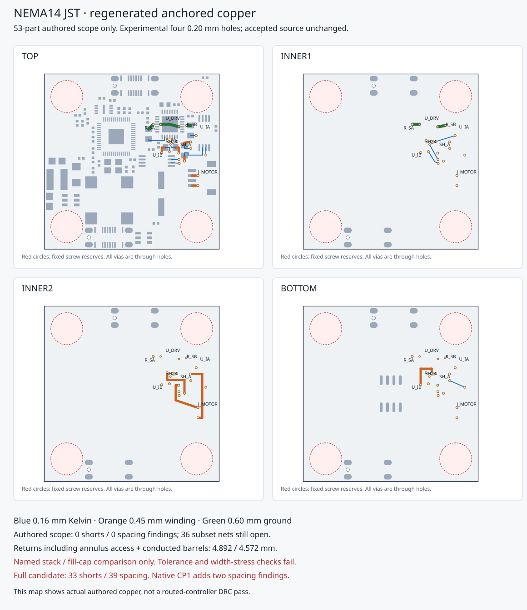

# NEMA14 JST: regenerated copper and fixed-path diagnosis

The separate compact experiment now has a clean authored driver/shunt/star scope and reproducible fixed copper in pinned native routing. **The full candidate is rejected. No production geometry, rule or accepted source is promoted.** Main, the original boards, and NEMA14 WAGO remain unchanged. The old MS3 escape remains diagnostic and is not copied into this candidate.

## First causes in the saved rejected candidate

`artifacts/iteration-6/first-causes.json` classifies every saved finding:

- All **39 spacing findings, including 33 shorts**, are moved component pads against original parts left unplaced. Counts by moved part: L_BUCK 12, U_BUCK 8, C_BUCK_IN 8, C_BUCK_OUT1 6, C_BUCK_OUT2 2, C_DV23 1, C_VM 1, C_BULK 1. None involves authored traces. Full and scoped authored world geometry matches; all **222** SRJ endpoints match real ports and all **257** pad obstacles match transformed pad bounds. Stale copper or stale pad obstacles are not the demonstrated cause.
- All **15 edge segment findings** belong to one newly automatic trace. Minimum actual copper-to-edge gap is **0.141522 mm**, below the unchanged 0.25 mm rule. They are safe-region violations, not proof every segment crossed the physical board boundary. Pinned checks 0.0.283 omit `pcb_trace` from their native edge checker, explaining its zero result; the independent trace-edge check remains required.
- Six authored shapes changed because pinned Core 0.0.2110 enrolls `pcbPath` as fixed and omits `pcbPaths`. The latter become editable prior traces. The enrollment code and native one-shunt A/B establish this independently of the placement collision.

## Native singular/plural A/B

The one-shunt test starts with **identical four authored route arrays**, actual 0.16 mm Kelvin and 0.45 mm winding legs, explicit physical terminal pairs, and a crossing net. It uses pinned Core 0.0.2110 / router 0.0.958, without dependency changes or Core patches.

| Native input | Editable prior traces | Changed authored records | Independent coupon result |
| --- | ---: | ---: | --- |
| Singular `pcbPath` | 0 | 0 | connected, zero shorts/spacing |
| Equivalent plural `pcbPaths` | 4 | 1 power branch | mutation reproduced; not fixed |
| Plural with explicit diagnostic fixed-input adapter | 4 removed before optimization | 0 | connected, zero shorts/spacing |

Eight real pad-removal controls pass across the initial and three routed cases. These are direct plural-path board evidence for [Core issue 5462](https://github.com/tscircuit/core/issues/5462) and [Core PR 5473](https://github.com/tscircuit/core/pull/5473), which is open and unmerged at this check. Its stated direct regression covers the straight-line case. [Closed, unmerged PR 5475](https://github.com/tscircuit/core/pull/5475) is a plural crossing reference. No upstream branch is adopted and no duplicate PR is opened.

## Regenerated native copper

`generate.py` rejects any placement input containing traces or vias. It resolves named ports, actual transformed supplier pad shapes, body-facing shunt edges, and driver outward pad tips from a fresh copper-free Circuit JSON. Parametric waypoints reference those real anchors; no old native IDs or prior world-copper coordinates are used. A shifted-shunt control proves the generated anchors and pickups move. Live source validation rejects mismatched generated anchors.

The new TSX fixture retains the eight logical Kelvin/winding paths, adds both explicit sense inputs, and checks both real 0.60 mm phase returns to the driver star. R_SB moves to (11.8, 6.2), rotation 90°. All four shunt-pad cuts still require the actual pad; shared winding copper outside each pad is zero. Kelvin wires stay 0.16 mm; winding wires 0.45 mm. All sense and return nets retain their actual native identities.

There are **32 authored fragments and 20 real through vias**. Twenty-nine fragments use supported singular `pcbPath`. Three remain clipped plural fragments: the two 0.45 mm driver pad-tip entries and RETURN_B_TOP's annulus landing. Forcing those three to singular extends copper to pad/via centers, producing **five independent spacing findings**, including 0.135375 mm at driver neighbors and 0.096727 mm near CP1. This is why singular is not substituted blindly. Mixed and all-plural variants have exactly equal nonzero physical segments, widths, layers and net identities; only duplicate zero-length singular endpoints are removed for that comparison. Actual routing preservation compares complete records without that normalization.

The explicit native `algorithmFn` adapter converts only live editable prior copper into conservative per-layer obstacles **before** optimization, retaining native fixed traces, real pad/via obstacles and screw exclusions. It does not restore or repair output copper. Rotated obstacles receive conservative world-axis envelopes. Conductor-center bounds ±16.95 mm derive from the actual ±17.5 mm outline, 0.25 mm edge clearance and 0.60 mm maximum envelope. The board boundary is unchanged.

## Before/after and bounded routing

| Measurement | Previous saved compact experiment | New separate experiment |
| --- | --- | --- |
| Accepted source locality | 25/59, 34 fail | unchanged |
| Full candidate locality | 40/59 | 41/59, 18 fail; 17 gains and one regressed control pass |
| Full authored candidate shorts / spacing | 33 / 39 | 33 / 39, rejected |
| Full authored candidate open nets | 66 | 64; two authored sense connections added, no aggregate routing |
| Clean 53-part authored scope | 28 traces / 18 vias, 38 open nets | 32 traces / 20 vias, 36 open nets; zero independent geometry findings |
| Bounded native output | nine nets: 1 short / 14 spacing / 15 edge segments; six changed fixed shapes | one net CP1: 0 shorts / 2 spacing / 0 edge; **zero changed fixed records** |
| Bounded scope open nets | 32 in a different nine-net scope | 35 in the 53-part scope; CP1 connected |

Different routed scopes are deliberately identified; their open counts are not comparable full-board progress. The accepted full-controller routing evidence still has 66 opens. The new full authored placement's 64 opens do not constitute a routed candidate. The full candidate retains the known buck bootstrap regression (28.669887 mm against a 4 mm target), driver supply/locality failures and unplaced-part collisions.

The native CLI command is captured as argv in `cli-guarded-CP1/exit.json`. It exercises `tsci build experiments/anchored/native-entry.tsx --disable-parts-engine --inject-props ...`, with a 53-part scope and only CP1 routing authorized by the adapter. Native CLI **exits 1**: 210 unconnected-port diagnostics and one pad/trace clearance diagnostic. The independent checker resolves that clearance into two offending segments against U_DRV.CP2: **0.149093 and 0.115307 mm**, required 0.15 mm. The input already declares 0.15 mm; it was not weakened. Solver “solved” is not a DRC pass.

All **32 trace and 20 via records are byte-equivalent before/after**, including coordinates, widths, net/source association and metadata. Two clipped driver endpoints and the real B annulus endpoint receive verified native terminal metadata before the preservation contract begins; this changes no copper. No automatic via is added by this one-net route. Three one-representable-value/source-identity mutation controls reject changes. No full-board autorouter is rerun.

The clean authored scope passes all 12 selected native geometric/thickness checks; all-routing native checks still report 212 port errors. The routed scope reports 210 port errors and one clearance error; native thickness checks report zero. Native warning absence alone is not width verification: every authored fragment's actual wire widths are independently checked. No warning or check is suppressed.

The actual winding branch planar sums are now **23.880346 / 19.895399 mm** (A/B), versus **23.996 / 21.794 mm** in the previous compact pass and **24.441 / 52.600 mm** in the original control. The new A driver leg is 8.950261 mm and B driver leg 8.649501 mm; these sums exclude conducted barrels, IC and winding conduction, and do not establish loop impedance or thermal capacity.

## Real return lengths and named manufacturing screen

The screen uses the published **JLC04161H-2116** 4-layer, nominal 1.6 mm stack: 1 oz finished outer copper 0.035 mm, 0.5 oz inner copper 0.0152 mm, pressed 2116 prepreg 0.1164 mm and core 1.265 mm. The table totals 1.5982 mm. Top-to-inner1 copper-center depth is **0.1415 mm**. This is a screening reference, not a selected supplier or order. Sources: [stack table](https://jlcpcb.com/impedance), [finished copper/pressed prepreg explanation](https://jlcpcb.com/help/article/multi-layer-pcb-standard-laminated-structures).

Each return is independently connected using only its three 0.60 mm wires, two actual annular barrels, sense-resistor ground pad and EP. All drilled holes are subtracted from planar copper; other ground pads cannot supply a hidden bypass. Removing either barrel of either return, or narrowing a return, fails.

| Phase | Actual planar wire | Added annulus-to-axis access | Two conducted barrels | Total | With assumed 0.160 mm maximum depth per transition |
| --- | ---: | ---: | ---: | ---: | ---: |
| A | 4.608754 mm | 0 | 0.283 mm | **4.891754 mm** | 4.928754 mm |
| B | 4.088565 mm | 0.200 mm | 0.283 mm | **4.571565 mm** | 4.608565 mm |

The unchanged limit is 5 mm. The complete physical through barrel spans the stack, but only the top-to-inner1 section conducts the modeled return; the remaining stub is not added as series path. Finished stack tolerances and the 0.160 mm engineering bound require confirmation. This is not impedance or current/thermal qualification.

The process comparison explicitly assumes **ENIG, mechanically drilled through vias, nonconductive epoxy filled, copper capped and planarized**. Four named compact holes become **0.20 mm / 0.45 mm pad** (V_STAR_A, V_STAR_B, V_GB, V_KBN_S); the other 16 keep 0.30 mm holes and increase pads to 0.55 mm. This violates the accepted 0.30 mm minimum-hole rule and is an **unapproved local comparison only**. Production minimum holes stay 0.30 mm.

Published hole position ±0.075 mm is screened separately from nominal drill edge and annulus clearance. The additional assumptions are +0.050 mm maximum hole-diameter growth and 0.015 mm copper registration budget: total radial allowance **0.115 mm**. These are procurement assumptions, not supplier guarantees. [JLCPCB says vias have no specified size tolerance](https://jlcpcb.com/help/article/pcb-via-covering); generic PTH tolerance is not substituted for via tolerance. The [capability rules](https://jlcpcb.com/capabilities/Capabilities) are screened separately: inner via-hole-to-foreign-copper 0.20 mm and component-PTH inner hole-to-copper 0.30 mm.

The old 0.30 mm star holes in 0.449872–0.450126 mm row slots give only +0.000063/−0.000064 mm after position alone, and about **−0.040 mm** with the additional assumptions. A 0.30 mm hole needs at least **0.530 mm** row gap for this tolerance model, roughly **0.080 mm more than the fixed supplier footprint provides**. A 0.25 mm hole also fails this model; the upper diameter in the tighter slot is 0.219872 mm. The 0.20 mm comparison provides about +0.010 mm star margin and +0.010 mm annular budget. It does not qualify the design: V_KBP_S still has **−0.006037 mm** hole-to-SMT margin under the same assumptions, and a +20% trace-width stress yields **11 spacing findings**. All 20 comparison vias pass the separate assumption-adjusted inner-via rule. Full supplier acceptance remains absent.

The specific decision exposed is whether a later candidate may use four small filled/capped through vias, or must move the star transitions outside the fixed narrow pad slots. Neither choice alone clears the known pad collisions, CP1 route, width-stress or locality gates. This is not a proof that all-top routing within 35 mm is impossible. No permanent assembly change is proposed.

## Mechanics, tests and limits

Full copper-free supplier OBJ bounds retain fixed USB, side JST, bottom encoder, top DNP capacitors and all four screw reserves. Changed-body gaps are at least **0.526246 mm** to screw projections and **1.984943 mm** to the catalog seated/withdrawal/service envelopes. Actual electrical copper and drills are independently screened on all four real layers. These are conservative model checks; no new STEP-kernel, fastener, motor/magnet, assembly, physical mating or cable-handling qualification is claimed.

`npm run test:anchored` replays native geometry, four pad cuts, phase-only returns, shifted-anchor regeneration, copper-input rejection, physical representation equivalence, the forced-singular negative case, exact record mutation controls, rejected manufacturing controls, and fresh native one-shunt A/B. It runs before the unchanged blocking locality gate. Typecheck includes all new TSX/TS. The routed CLI failure and all independent findings are preserved, not converted into a passing board build.

Large raw JSON evidence is losslessly compressed. From this study directory, run `python3 experiments/anchored/expand-artifacts.py` to verify every gzip/hash and restore exact native inputs and outputs before manual replay. The regression suite reads compressed saved evidence directly and generates fresh native replay separately.
