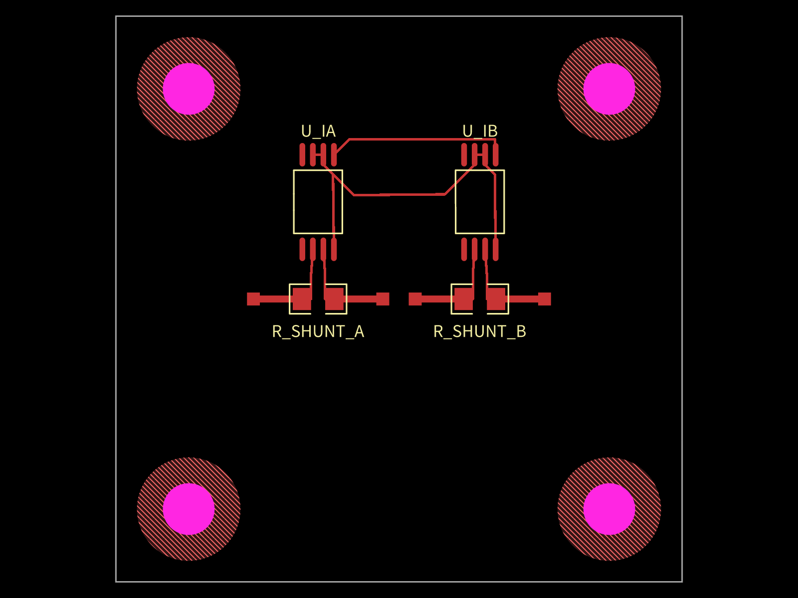
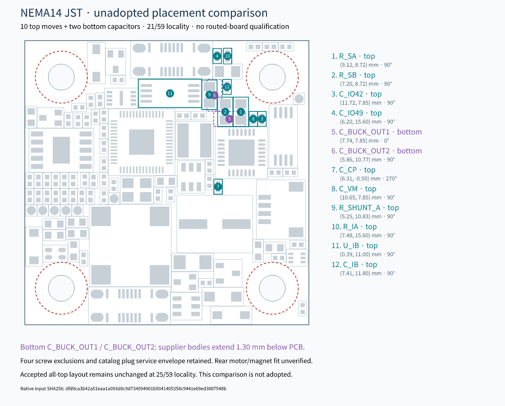

The integration status below records the earlier coupon pass. See the [NEMA14 JST full-controller integration report](full-controller-kelvin-integration.md) for the subsequent eight-path candidate and current blockers.

# NEMA14 JST authored copper experiment

The accepted controller stays at 25/59 locality passes, with 0 traces and 0 vias. This pass adds a verified native Kelvin coupon and an explicitly unadopted placement comparison. It does not replace the intended top-side assembly, waive locality or provide a clean routed board. Original board files and NEMA14 WAGO are unchanged.

## Verified pad-edge breakout and preservation

The [native TSX coupon](../experiments/kelvin/fixture.tsx) uses the exact supplier 50 mΩ shunt and INA240 footprints. Each of four 0.16 mm Kelvin paths leaves the actual body-facing pad edge. Each separate 0.45 mm winding-current path leaves the opposite edge. The centerline breakpoints lie on the actual pad boundary; copper sharing is confined to the real pad. All eight critical paths are authored completely with `trace pcbPath`; the remaining supply nets use the ordinary native autorouter.

`npm run test:kelvin` runs **both native CLI builds**, first authored-only and then routed, and checks their generated copper. All eight paths retain identical coordinates, layers and widths. All four physical pad-cut tests pass: removing only the actual shunt pad disconnects the amplifier from the winding-current conductor. The routed coupon has 14 traces, no vias, zero native error records and no independent shorts, opens, copper/drill/hole/edge or screw-reserve violations. Each Kelvin path is about 3.643 mm; each winding-current coupon path is 3.000 mm. These are coupon dimensions, not measurements of the controller.

The installed core 0.0.2110 recognizes authored `pcbPath` traces as fixed, converts them to obstacles for subsequent routing, and retains their original copper in the native output. This is the verified native preservation mechanism. It also preserves the two authored returns in the real full-board obstacle context below. Geometry preservation alone does not prevent a later same-net branch attaching to a Kelvin conductor; actual-pad topology must still pass after routing the complete controller. Full integration of all four Kelvin and winding paths into the controller remains unfinished.

The native thickness checker examines other copper on the same net and emits four warnings comparing the coupon's intentional 0.16 mm Kelvin paths with the 0.45 mm winding-current requests. Warnings are retained. The independent check measures all four actual authored power routes at 0.45 mm and all four Kelvin routes at 0.16 mm; no native DRC is disabled.

Authored native traces can omit a direct copper connectivity key. The independent checker now resolves it only through existing native source-trace IDs, and via identities through their native trace IDs. It changes no geometry and rejects conflicting explicit identities. Three new regressions cover resolution, conflicts and unknown identities; all 14 copper regressions pass.

## Concrete placement comparison

A constructive all-top cluster put both regulation resistors beside the driver's sense pins and reserved their returns, rather than repeating the previous global slot search. Three bounded geometric corrections still left MCU/inductor pad and courtyard conflicts. The failed native checkpoint is recorded in [top-cluster-blocked.json](../artifacts/iteration-2/top-cluster-blocked.json). This is not proof that all-top assembly is impossible.

A separate [TSX wrapper](../experiments/kelvin/two-cap.tsx) applies [12 explicit placement changes](../experiments/kelvin/two-cap-changes.json): ten top-side parts move and only C_BUCK_OUT1/C_BUCK_OUT2, the two 22 µF output capacitors, move to the bottom for comparison. The accepted placement JSON is untouched. This comparison is **not approved or adopted**.

The wrapper's native PCB geometry matches the measured candidate exactly, apart from project metadata. Native placement DRC passes. The 35 mm outline, both USB poses, side-facing header, bottom encoder, four holes and four screw reserves remain fixed. Unchanged supplier transforms are checked against the accepted source. Conservative transformed supplier OBJ bounds for the 12 moved parts clear all four screw projections and the existing catalog plug/withdrawal/service envelopes. Both bottom capacitor bodies project about **1.30 mm below the lower PCB face**. This does not qualify rear motor/magnet clearance, solder assembly, tolerances, capacitor mounting, thermal performance or handling. The comparison used PCB-only native configuration (`schematicDisabled: true`) in an isolated checkout; no PCB DRC checks were disabled. Raw experimental snapshots retain evaluator-relative CAD asset URLs; use the TSX wrapper to rebuild in the review checkout.

The tradeoff is unfavorable overall: **25/59 → 21/59** locality passes, with ten P0 distance increases. Both SENSE pin-1 distances improve, but INA bypass, buck output, ADC and MCU locality tradeoffs remain in [the complete report](../artifacts/iteration-2/report.json). Additional vias and switching-return behavior of bottom output capacitors are unqualified. This is a reviewable small alternative, not a placement recommendation.

## Native routing with authored returns

The first authored returns used vias in pads. Native placement rejected them and skipped routing; that rule was retained. The revised paths use external via landings, including landings beside the exposed-pad region. Both authored returns use actual **0.60 mm wires and 0.45/0.30 mm via pads/drills**. The annular/barrel cross-section is not a 0.60 mm wire.

The documented [native `algorithmFn` interface](https://docs.tscircuit.com/advanced/create-or-use-custom-autorouter) receives the core's full 78-connection problem after fixed copper becomes obstacles. A diagnostic adapter selects the same nine driver connections as the prior pass and retains all **425 native obstacles**, including the authored copper. It uses the installed native router and unchanged widths/clearances, with a nominal 60-second solver bound and 95-second external bound. It solved in the observed run at 23.69 seconds. The real native CLI materialized 24 traces and 19 vias. Both authored returns remain byte-identical to the authored-only routes; both pass independent 0.60 mm width/continuity checking.

| Measurement | Prior driver subset | Two-capacitor comparison |
| --- | ---: | ---: |
| SENSE1 complete wire centerline sum | 12.681 mm | 2.013 mm |
| SENSE2 complete wire centerline sum | 13.658 mm | 2.056 mm |
| SENSE1 minimum actual wire width | 0.2125 mm | 0.2800 mm |
| SENSE2 minimum actual wire width | 0.1875 mm | 0.2800 mm |
| Authored return A source-to-EP landing | no directly matched authored leg | 6.327 mm |
| Authored return B source-to-EP landing | no directly matched authored leg | 5.526 mm |
| Scoped connections physically joined | 9/9 | 9/9 |
| Independent shorts | 0 | 0 |
| Independent clearance findings | 1 | 12 segment findings / 7 primitive pairs |

The authored return wire sums including travel within the exposed-pad region are 8.079/7.347 mm. The previous shared GND tree has no directly matched authored return leg, so no qualified closed-loop before/after length is claimed. Wire sums do not measure loop area, inductance or current sharing. Both revised source-to-landing paths exceed the unchanged 5 mm engineering target; shorter sense legs alone do not qualify the circuit.

**The routed comparison is rejected.** Native DRC reports SENSE1/VBB1 spacing of about 0.094 mm, VCP/VBB2 spacing of about 0.131 mm and an automatic via hole overlapping RESET_N. The independent screen also finds 12 clearance segment findings and 64 disconnected full-board nets. Native output retains 311 open-port and eight missing-trace errors from deliberately omitted nets. The separate controller Kelvin/USB problems remain unresolved. A solved nine-connection subset is not routed-board DRC.

[Native routing receipt](../artifacts/iteration-2/driver-native-result.json) · [Actual native partial copper](../artifacts/iteration-2/two-cap-driver-routed.circuit.json) · [Return preservation](../artifacts/iteration-2/return-preservation.json) · [Independent copper evidence](../artifacts/iteration-2/two-cap-driver-copper.json) · [Moved-body fit screen](../artifacts/iteration-2/two-cap-body-bounds.json)

## Reproduce and limits

Run `npm run test:kelvin`, `npm run test:copper` and `npm run typecheck` in the study. Python needs the existing geometry requirements. The coupon regression writes only ignored `.config`/`dist` outputs. It does not change controller copper.

Placement and driver comparisons are optional diagnostics in a separate checkout using `partsEngineDisabled: true, schematicDisabled: true` in its platform config. Build `experiments/kelvin/two-cap.tsx --routing-disabled`, then `experiments/kelvin/driver-returns.tsx --autorouter-timeout 65s`. The custom adapter writes its raw native input/output into ignored `.config/driver-comparison`. Its reduced connection set is explicit; it is not a production entry or replacement for `npm run autoroute`.

The accepted controller still requires 34 locality fixes, complete actual-pad Kelvin integration, both acceptable ground-return paths, complete native routing and independent DRC, USB return reference/impedance, rear mechanical fit and hardware verification. Keep PR #2 draft. No merge or order.

The production `npm run autoroute` command was re-exercised in this pass with an external 180-second bound. It timed out during native generation before locality/routing, so a fresh full production build is not claimed. The accepted native source SHA256 remains `fe986e028cb398ebf3ed7fcbd9fd5dd8133b64c80aeac673c0540aa5c98cf06b`; its original locality gate was rechecked at 25/59. Completed CI on starting head `9031251` passed native source, electrical and placement checks and failed locality. Typecheck, the native Kelvin regression and all 14 copper regressions pass locally on this update.

