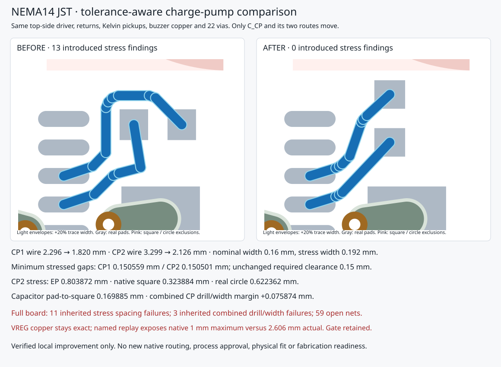

# NEMA14 JST: tolerance-positive charge-pump copper

This separate TSX comparison removes all **13 introduced charge-pump width-stress findings**, reducing the full unchanged gate **24→11**. **It is not promoted**: eleven inherited spacing findings, three inherited combined width/drill failures, a newly exposed native VREG length diagnostic, sixteen locality failures and 59 open nets remain. The accepted controller, prior candidates, main, original boards and NEMA14 WAGO stay unchanged. No merge/order.

## Actual local change and preserved copper

C_CP moves from `(11.75,8.85,0°)` to **`(11.5,8.96,90°)`**. Its two singular native paths regenerate from actual transformed pad anchors. No other part moves and no via is added, removed or moved. All 35mm outline/USB/JST/encoder/DNP capacitor/screw locks, source pin/net contract, and top-side assembly pass.

A coordinated geometric search reserves the complete stressed CP1 corridor while finding CP2. It uses real full-board obstacles, +20% widths, conservative native square keepouts and a 0.0025mm construction grid. The acceptance clearance stays **0.15mm**. This is an offline construction, not an autorouter result. The final native board is checked independently. Earlier sequential routes each passed alone but blocked the other; neither was accepted. No claim of all-top impossibility is made.

| Native copper | Before | After |
|---|---:|---:|
| CP1 actual wire, mm | 2.296223686 | **1.820361719** |
| CP2 actual wire, mm | 3.298707623 | **2.125733603** |
| Actual / stressed width, mm | 0.16 / 0.192 | unchanged |
| CP1 minimum stressed copper gap, mm | fails | **0.150558805** |
| CP2 minimum stressed copper gap, mm | fails | **0.150501260** |
| CP2 stressed EP gap, mm | — | **0.803871958** |
| CP2 stressed native-square gap, mm | — | **0.323884258** |
| CP2 stressed real-circle gap, mm | — | **0.622362230** |
| Tight capacitor pad-to-square gap, mm | — | **0.169884500** |

The combined external charge-pump PCB wire decreases **5.594931309→3.946095322mm**. Package-internal paths and inductance are not measured. The residual stress clearance above 0.15mm is only about **0.5µm** at the tightest point; this is a positive result under the stated model, not a supplier guarantee or comfortable fabrication margin. Pad etching dimensions and actual process distributions still need acceptance.

**42 non-CP route arrays**, including the native VREG geometry, match the previous native output exactly in coordinates, widths, layers, terminal IDs and net. Forty-one retain their source/PCB identities; VREG is explicitly re-enrolled in TSX with a named source trace, preserving its exact physical route and terminals. All **22 via whole records** remain exact. All four real shunt-pad cut checks and separate Kelvin branches pass, with zero shared winding copper outside the pads. The actual 0.60mm returns remain **4.891753690 / 4.564926188mm**, including annulus access and conducted barrels; both upper-depth totals remain below5mm. Every cleaned buzzer route is unchanged.

## All 24 former findings, by real primitive

The old 24 counts are findings after the existing inspector's object/layer/rounded-gap deduplication, not 24 unique net pairs. The map lists every matching primitive pair within that same 1µm matching resolution; equal-distance adjacent segments remain explicit rather than choosing an arbitrary owner. JSON retains world centerlines, widths, exact nearest points and all candidate segment pairs. Segment indices are zero-based in the native route array.

| Index | Origin | Copper path / segment(s) | Offending object / segment(s) | Nominal gap, mm | Stress gap, mm |
|---:|---|---|---|---:|---:|
| 0 | inherited | POWER_B_DRV__2[1] | U_DRV.SENSE2 | 0.154596678 | 0.109597525 |
| 1 | inherited | POWER_B_DRV__2[1] | U_DRV.NC25 | 0.154596678 | 0.109597525 |
| 2 | inherited | POWER_A_DRV__2[0] | U_DRV.NC25 | 0.154596678 | 0.109597525 |
| 3 | inherited | POWER_A_DRV__2[0] | U_DRV.SENSE1 | 0.154596678 | 0.109597525 |
| 4 | inherited | RETURN_A_EP[0]; RETURN_A_EP[1] | U_DRV.DIR | 0.179401236 | 0.119402366 |
| 5 | inherited | RETURN_A_EP[0]; RETURN_A_EP[1] | U_DRV.REF | 0.179401236 | 0.119402366 |
| 6 | introduced | AUTHORED_CP2_CORRIDOR[0] | U_DRV.VCP | 0.156669047 | 0.140669047 |
| 7 | introduced | AUTHORED_CP2_CORRIDOR[1] | U_DRV.VCP | 0.152989399 | 0.136989399 |
| 8 | introduced | AUTHORED_CP1_CORRIDOR[0] | U_DRV.CP2 | 0.156669047 | 0.140669047 |
| 9 | inherited | RETURN_B_EP[0]; RETURN_B_EP[1] | U_DRV.CP1 | 0.179325562 | 0.119327339 |
| 10 | inherited | RETURN_B_EP[0] | U_DRV.ENABLE_N | 0.179326210 | 0.119327339 |
| 11 | inherited | RETURN_B_EP[1] | U_DRV.ENABLE_N | 0.179322693 | 0.119323119 |
| 12 | introduced | AUTHORED_CP2_CORRIDOR[2] | C_CP.pin1 | 0.159889500 | 0.143889500 |
| 13 | introduced | AUTHORED_CP2_CORRIDOR[3] | C_CP.pin1 | 0.153966748 | 0.137966748 |
| 14 | introduced | AUTHORED_CP2_CORRIDOR[4] | C_CP.pin1 | 0.153444586 | 0.137444586 |
| 15 | introduced | AUTHORED_CP2_CORRIDOR[8] | C_CP.pin1 | 0.153047631 | 0.137047631 |
| 16 | introduced | AUTHORED_CP2_CORRIDOR[7] | C_CP.pin1 | 0.152659275 | 0.136659275 |
| 17 | introduced | AUTHORED_CP2_CORRIDOR[6] | C_CP.pin1 | 0.160251000 | 0.144251000 |
| 18 | introduced | AUTHORED_CP2_CORRIDOR[5] | C_CP.pin1 | 0.152583408 | 0.136583408 |
| 19 | inherited | POWER_B_DRV__0[1]; POWER_B_DRV__0[2] | C_VM.pin2 | 0.154998000 | 0.109998000 |
| 20 | introduced | AUTHORED_CP1_CORRIDOR[3] | R_SB.pin2 | 0.157266101 | 0.141266402 |
| 21 | introduced | AUTHORED_CP1_CORRIDOR[1] | R_SB.pin2 | 0.156956644 | 0.140956644 |
| 22 | introduced | AUTHORED_CP1_CORRIDOR[2] | R_SB.pin2 | 0.152311702 | 0.136311702 |
| 23 | inherited | AUTHORED_SENSE_B__2[0]; AUTHORED_SENSE_B__2[1] | POWER_B_DRV__2[1] | 0.195380000 | 0.134380138 |

All thirteen introduced findings belong to four object pairings: CP2 versus VCP, CP1 versus CP2, CP2 versus C_CP.pin1, and CP1 versus R_SB.pin2. All eleven inherited findings survive exactly, with their original paths and gaps. No gate entry, NC pad, clearance threshold or width target is removed.

## Width and drill tolerances together

The manufacturer explicitly publishes **±20% track-width tolerance** and illustrates both growth and shrinkage. Therefore positive-width stress has a factual basis and remains unchanged. The published 1oz pad-to-track minimum is 0.1mm, but this project's stricter **0.15mm** rule remains its gate; the factory minimum is not substituted. [Published capabilities](https://jlcpcb.com/capabilities/Capabilities).

The existing named JLC04161H-2116 screening model remains unapproved: four 0.20/0.45mm and eighteen 0.30/0.55mm hole/pad vias, ENIG, mechanical through holes, epoxy filled/capped. Published ±0.075mm position tolerance is kept separate from assumed +0.050mm diameter growth and assumed 0.015mm registration, a 0.115mm radial budget. Stack tolerances and supplier acceptance remain unconfirmed.

The legacy nominal drill/annulus screen still passes all22 under those assumptions, with minimum adjusted SMT/annular margins **+0.009936 / +0.010000mm**. The original minimum-0.30mm process remains a failing control; this work does not approve its alternate holes.

A **supplemental combined** audit widens foreign traces by20% while applying the 0.115mm hole budget and published **0.20mm hole-to-track** rule on their actual layers. Both new CP routes pass every existing via, minimum excess margin **+0.075874082mm**. Repeating the CP check with the original **0.30mm holes** still gives **+0.025874103mm** minimum CP margin; the fix does not require smaller holes. That original full-board control still fails three adjusted SMT, four annular and one inner-via checks. Three inherited pairs fail and remain blockers: POWER_A_DRV__1 versus V_KBN_S (pcb_via_12) on inner2 (**−0.035mm**); POWER_B_COIL__1 versus V_KBP_T (pcb_via_11) on inner2 (**−0.035mm**); AUTHORED_SENSE_A versus V_PA_D (pcb_via_1) on top (**−0.010198353mm**). The existing gate is retained alongside this stricter combined analysis. No failed physical copper is changed or routed over.

## Native source replay and VREG diagnostic

The pinned CLI entry point is tested with `tsci build experiments/tolerance/candidate.tsx --routing-disabled --disable-parts-engine --inject-props '{"process":"small-hole-screen"}'`. The documented temporary schematic-drawing control is used; all normal configuration bytes are restored. The CLI exits **0 for source generation only**, in11.065663s. Its source contract, mechanical geometry and physical copper/layers/nets/widths match the independent API output exactly. Only three nonphysical driver/annulus endpoint annotations, already used by the fixed-copper audit, differ and are enumerated in audit.json. This is not routed-controller DRC.

Independent full-board checks: **zero shorts, nominal spacing, courtyard, edge, screw, drill/hole findings**, all101 top courtyards. Locality remains **43/59**, all previous passes retained; accepted production remains25/59. There are **44 traces,22vias,59open nets**. Selected native geometry/thickness checks all return zero.

All native routing checks retain **300 port errors, four style warnings and one length error**. Explicitly re-enrolling the unchanged native VREG route gives its named source trace a Core-generated **max_length=1mm**; the former source_trace_188 represented one physical port plus net.VREG and had no max_length field. The actual path remains **2.605856312mm** and the new error is kept. No max-length override, warning suppression or identity trick is used. This exposes a coverage/ownership difference, not a physical VREG improvement.

At the current placement, VREG port-centre separation is **2.257762453mm**, and even the physical pad-edge lower bound is **1.366017361mm**. A1mm route cannot fit those present pad locations. Resolving that native limit geometrically requires a separate C_VREG placement and fixed-path requalification; current fixed VREG copper is preserved. The 1mm value is reported as the native inferred rule, not asserted as a numeric datasheet limit.

**No new native routing stage runs.** The full width-stress gate is still red at11 findings; the three combined drill failures, VREG limit, unapproved drill option and sixteen locality failures also block promotion. Rendering/source slowdown is separate from these physical failures. The environment restarted and cleared temporary work once; the final deterministic source and checks were rebuilt and saved in persistent storage, reproducing the geometry.

Supplier-body bounds for69 moved bodies retain ≥**0.300mm screw / 0.941663mm plug-service** gaps. Tightest existing courtyard/screw gap remains0.007047mm. Actual motor/magnet fit, connector handling, process acceptance, thermal/current capacity, full routing and CAM remain unverified.

## Reproduction

```sh
bun install --frozen-lockfile
python3 -m pip install -r requirements-geometry.txt
python3 experiments/tolerance/expand-artifacts.py
npm run typecheck
python3 experiments/tolerance/test.py
# Optional deterministic offline construction, not native autorouting:
python3 -m pip install -r requirements-tolerance-planner.txt
bun experiments/tolerance/render.ts artifacts/iteration-9/seed.circuit.json --small-hole-screen --without-charge-pump
python3 experiments/tolerance/plan.py artifacts/iteration-9/seed.circuit.json
```

The CI guard replays the complete native placement and rejects one-ULP fixed-copper drift, CP width changes and VREG length-limit suppression. It requires all inherited failures to stay visible, all four actual Kelvin pickups, both real returns and the new CP margins. No router reruns in CI. The original production locality gate remains unchanged.


