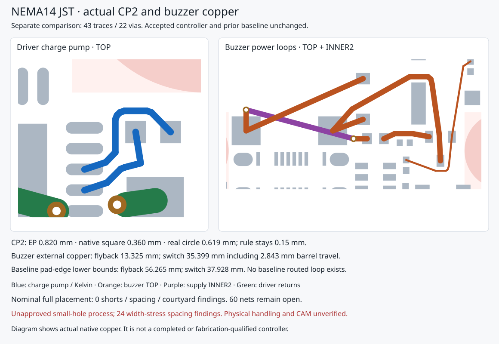

# NEMA14 JST: CP2 and buzzer copper comparison

This is a separate TSX comparison built on the clean full-placement baseline at `6b6aa34`. It is **not promoted**. Accepted controller source, the prior candidate, original boards, main and NEMA14 WAGO are unchanged. Nominal placement and copper pass, but the charge-pump refinement adds manufacturing-stress failures. The alternate small-hole process remains unapproved. No merge or order.

## Real CP2 failures and corrected native copper

The previous automatic CP2 trace `source_net_21_0` (`source_trace_186`) violated the **actual U_DRV exposed pad**, `pcb_smtpad_195`, on top. Segment 3, `(9.438860768,8.037054021) → (9.401017922,8.660409711)`, has **0.120894143 mm** copper-edge clearance. Segment 4, `(9.401017922,8.660409711) → (9.398782443,9.218424189)`, has **0.119332295 mm**. Both fail the unchanged 0.15 mm rule. These are physical failures, reproduced from real capsule pad/trace geometry.

The existing keepout diagnosis is reused: the former trace has **0.089998 mm** to the native square bounds versus **0.317135 mm** to the actual radius-3.2 mm circle. Pinned checks 0.0.283 uses the bounding box in this check. No checker is changed, keepout reduced or error suppressed.

The separate comparison moves C_CP down **0.25 mm**, reroutes CP1 and explicitly authors a singular CP2 path from the live transformed terminals. It clears **both** interpretations:

| Actual copper | CP1 | CP2 |
|---|---:|---:|
| Wire length, mm | 2.296224 | 3.298708 |
| Width, mm | 0.16 | 0.16 |
| Minimum other-copper gap, mm | 0.152312 | 0.152583 |
| Exposed-pad gap, mm | 0.819871 | 0.819871 |
| Native square gap, mm | 0.870000 | 0.359747 |
| Actual screw-circle gap, mm | 1.193480 | 0.619095 |
| Highest centerline y, mm | 8.850000 | 9.360253 |

The earlier y≤9.57 mm bound is only a starting bound; the independent screen measures the complete real copper. The prior CP1 path was 2.217847 mm with 0.175962 mm minimum gap. Its intentional replacement gains 0.078376 mm length and loses 0.023650 mm minimum clearance. Every other **32 prior trace records and all 20 prior via records remain exactly unchanged** before native routing. Four real shunt-pad removal tests still prove separate Kelvin pickups with zero shared winding-current copper outside the pads. Kelvin, winding and return widths stay 0.16 / 0.45 / 0.60 mm.

## Buzzer placement and actual loops

Thirteen local part poses change, recorded in `poses.json`. BZ1 shifts left 0.25 mm; C_BULK shifts right 0.08 mm. The diode, MOSFET, capacitor and gate resistors cluster near the buzzer. Indicators and one bare test point move to make room. USB/ESD, MCU decoupling, crystal, ADC cluster and locked mechanical parts do not move. All fitted assembly stays top-side; the encoder remains bottom and its DNP capacitors remain top.

The final source contains **43 native traces and 22 physical through vias**. This intentionally adds 10 traces over the 33-trace baseline and two supply vias at `(0.58,-12.0)` and `(-8.349815,-9.60)`, each **0.30 mm hole / 0.55 mm pad**. The supply crosses on inner2, with top stubs. Every new trace's real geometry, layer, width, source net and physical endpoints match the authored specification. The original 20 vias stay fixed. The pulldown ground branch remains open; no complete buzzer or controller is claimed.

The baseline has no routed buzzer loop. Consequently, the comparison uses its **optimistic physical pad-edge lower bounds**, not fabricated previous route lengths. New values are measured from actual native copper; the switch supply includes two conducted top-to-inner2 barrels, **2×1.4217=2.8434 mm**, in the named nominal stack.

| External PCB path | Baseline physical edge lower bound, mm | New actual wire plus barrels, mm |
|---|---:|---:|
| Flyback, two branches | 56.265027 | **13.324631** |
| Switch/supply/return, three branches | 37.928370 | **35.399209** |

These actual new external paths are shorter even than the old geometry's ideal lower bounds, by at least **42.940397 / 2.529161 mm**. Package-internal paths, full loop inductance and EMI are not measured. Individual lengths, real native fragments and net keys are in `copper-and-loops.json`. Isolated continuity tests subtract all drilled holes from planar copper and include actual annular barrels. Removing either new supply via breaks that branch. Gate/pulldown-to-gate copper also passes; pulldown-to-ground remains unconnected. The drain route is 16.583041 mm because the checked top-side return corridor must stay clear; a shorter earlier drain blocked that return and was rejected.

## Full-board and manufacturing comparison

Both candidates retain **43/59 locality passes**, including every previous pass. The 16 remaining failures are unchanged. Accepted production locality remains **25/59, 34 fail**; its blocking gate is untouched.

The authored comparison independently has **zero shorts, spacing, courtyard, drill/hole, board-edge or screw findings**, all 101 top courtyards checked, and **60 full-board open nets** versus 63. Native selected geometric/thickness checks all report zero. All-routing checks retain **302 port errors and four odd-angle style warnings**. The style warnings identify actual long segments in the inner2 supply, flyback supply, switch drain and gate-pulldown paths; they are retained, not silenced or disguised by subdivision. They are not thickness failures.

Both actual 0.60 mm driver returns are unchanged: **4.891754 / 4.564926 mm** including annulus access and conducted barrels. The stated 0.160 mm depth upper bound yields **4.928754 / 4.601926 mm**, still below the unchanged 5 mm target. Finished stack tolerances remain unconfirmed.

The named JLC04161H-2116 ENIG / mechanical-through / epoxy-filled-and-copper-capped model is a **screening option**, not supplier approval or an order. Four earlier 0.20/0.45 mm vias remain unapproved; the other 18 are 0.30/0.55 mm. Published ±0.075 mm position tolerance, assumed +0.050 mm hole growth and assumed 0.015 mm registration stay distinct, totaling a 0.115 mm radial screening budget. Nominal drill-edge, position-only and assumption-adjusted drill/SMT, annulus and per-layer foreign-copper margins are retained separately. All 22 pass the stated conditional screen; minima remain **+0.009936 mm SMT / +0.010000 mm annular**. Separate inner-via 0.20 mm and component-PTH 0.30 mm rules pass. The two new vias individually have +0.265162 / +0.274919 mm adjusted drill-to-SMT margins. The original minimum-0.30 mm process remains a failing control: three adjusted SMT, four annular and one inner-via failures. [Published capability reference](https://jlcpcb.com/capabilities/Capabilities).

**Width +20% stress regresses from 11 to 24 spacing findings**, zero shorts. All 11 prior findings remain; all 13 additions belong to the new charge-pump corridors. The comparison therefore fails promotion despite nominal DRC passing. A bounded 0.19 mm planning-margin alternative clears CP1 at 0.190250 mm, but its CP2 search cannot complete after 2,169 explored nodes. The valid nominal source is restored; this is not proof that all-top placement is impossible. `refinement-rejection.json` and `width-stress-causes.json` keep this tradeoff explicit. A further local capacitor/return-corridor placement change is required before promotion, rather than reducing any threshold.

Supplier OBJ bounds for 69 moved physical bodies clear the screw reserves by at least **0.300 mm** and plug mating/withdrawal/service envelopes by **0.941663 mm**. The tightest courtyard-to-screw-circle gap is only **0.007047 mm**: nominally positive, not a tolerance or handling qualification. Bare test-point markers are excluded from supplier-body counts but their courtyards remain checked. Rear motor/magnet fit, connector handling and real assembly fit remain unverified.

## Native entry point and generation isolation

The direct pinned `tsci build experiments/reconnect/native-entry.tsx --disable-parts-engine` attempt is killed with **exit 137** during generation, before the routing adapter or SRJ input is written. That alone does not prove an out-of-memory cause. Routing-disabled generation with the normal schematic renderer also exceeds a bounded 45 seconds. With **only schematic drawing disabled**, the pinned local-asset generation completes in **8.947335 seconds**, and its source ports, nets, copper, pads, vias, board, holes and keepouts are exactly identical to the independently checked API output. No catalog, design, package pin, dependency, upstream code or PCB DRC rule changes.

`cli-screen.py` records the temporary renderer configuration and always restores the exact normal config. It is a diagnostic runner, not a normal-build success claim. `generation-diagnosis.json` records all controls. The single gated VREG step uses this proven rendering control, the full actual board obstacles, fixed authored copper and the same native CLI. It solves VREG in **9.038425 seconds** (CLI wall time 19.586154 seconds), adding one **2.605856 mm, 0.16 mm** trace and no vias. All **43 authored trace and 22 via records remain byte-equivalent**, serialized SHA-256 `8307c1270e5b581ab21ac60716f2020cddfbd852fc2c58511892846d0eb8c410`. Independent checks find **0 shorts / spacing / drill / edge / screw findings and 59 full-board open nets**. Selected native geometry/thickness checks are all zero; all-routing checks report **300 port errors and four retained style warnings**. The **CLI exits 1**, correctly rejecting the incomplete controller. Width-stress findings remain 24 after this step. Its exact outcome is in `native-VREG/verification.json` and the top-level verification receipt. No aggregate rerun follows.

## Reproduction and limits

```sh
bun install --frozen-lockfile
python3 -m pip install -r requirements-geometry.txt
python3 experiments/reconnect/expand-artifacts.py
npm run typecheck
python3 experiments/reconnect/test.py
# Replaying the saved native step is deliberately separate from CI:
python3 experiments/reconnect/preflight.py
PATH="$PWD/node_modules/.bin:$PATH" XDG_CONFIG_HOME=.config \
  python3 experiments/reconnect/cli-screen.py VREG
```

Tests replay all native physical records, source contracts, real pad cuts and drilled-barrel paths; reject missing barrels and geometry/width mutations; preserve the known old EP failures and manufacturing rejection. The existing guards remain in CI before the unchanged production locality gate. The normal config, accepted controller SHA-256 `fe986e028cb398ebf3ed7fcbd9fd5dd8133b64c80aeac673c0540aa5c98cf06b`, prior candidate and original boards remain unchanged.

Remaining gates include charge-pump manufacturing margin, original via-process geometry or explicit process approval, 16 candidate locality failures, unconnected pulldown ground and the full-board open nets, USB reference/return continuity, thermal/current capacity, full native routing/DRC, CAM, supplier acceptance and physical fit. This comparison is useful verified progress, not fabrication readiness.


