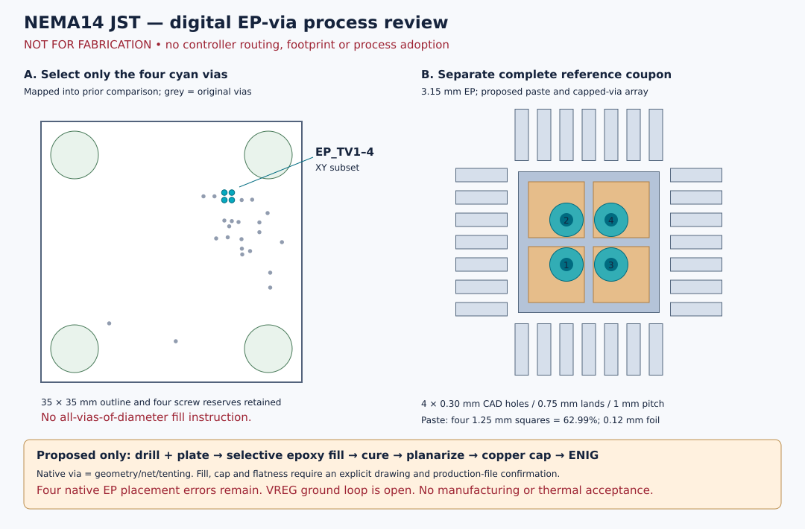

# NEMA14 JST intentional EP-via process comparison

**Recommendation: retain the current board and footprint; review a four-layer, selectively epoxy-filled and copper-capped EP-via process before integrating it.** This is a digital decision package, not a fabrication release. No external-escape placement search or routing is repeated. No new controller copper, manufacturing exception, supplier contact or order is introduced.

## Exact device and proposed local geometry

The fitted device remains **Allegro A4988SETTR-T, ET package**, catalog C38437. Its [Rev8 drawing, page19](https://www.allegromicro.com/-/media/files/datasheets/a4988-datasheet.pdf) specifies a reference **3.15mm square EP**, 1.15×0.30mm peripheral rectangles, 0.50mm pitch and 4.80mm opposite-row centre separation. The imported board pattern is different and remains unchanged; see the preceding [NEMA14 JST comparison](external-star-decision.md). The manufacturer requires soldered PAD ground, external GND3/18 ties and low-impedance sense/star returns, and recommends thermal vias. Neither the drawing nor its generic [soldering guidance](https://www.allegromicro.com/-/media/files/application-notes/an26009-soldering-methods-for-allegro-products.pdf) qualifies this board's fill, cap, stencil or thermal performance.

The separate TSX coupon uses the complete published reference, **not a replacement production footprint**. It contains four own-ground mechanical through-vias at local (±0.50,±0.50)mm: **0.30mm nominal CAD hole, 0.75mm land**, 1.00mm pitch. These intentionally sit within EP. The larger proposed lands belong only to this new process study; existing 0.30/0.55mm board vias remain unchanged. EP and all four vias resolve to the same native source net. No plane or return trace is authored.

A possible later integration would relocate V_STAR_A/B to EP_TV1/3 and add EP_TV2/4 as thermal stitches: 22−2+4=24 vias. That mapping is a proposal, not a changed controller. Both sense-resistor returns must still be at least0.60mm on planar copper and at most5mm including pad access and every conducted barrel. Their actual shunt pads and the four INA240 Kelvin pickups must remain separate from winding-current copper. The proposed EP array could remove the compulsory narrow peripheral-ground bridge, but no qualifying return length/width or complete motor loop is claimed here.

## Published capability versus unconfirmed requirements

The historical screen is **JLC04161H-2116, four layers, 1.6mm, ENIG**. Its [published nominal stack](https://jlcpcb.com/impedance) is 0.035/0.1164/0.0152/1.265/0.0152/0.1164/0.035mm; top-to-inner1 centre travel is0.1415mm. Finished layer tolerances remain unconfirmed. No fabrication/assembly tier was found as an approved selection, so Economic and Standard are compared rather than silently choosing one.

| Item | Current official publication | Status for this design |
| --- | --- | --- |
| Drill/registration | Hole position ±0.075mm; average plating18µm; via-to-foreign-copper minimum0.20mm on inner layers | Minimum barrel/cap copper and via hole-size/registration tolerances **unconfirmed** |
| Hole-size semantics | The via guide explicitly gives vias no specified tolerance; +0.13/−0.08mm refers to component-pad through-holes | Do not assign generic PTH tolerances to these vias; confirm CAD/drill/finished dimensions |
| Fill | Nonconductive epoxy fill followed by copper plating is offered for via-in-pad | Four-layer availability is published as an extra-cost option; exact stack/assembly compatibility and price **unconfirmed** |
| Planarity | Generic blog: cap≥5µm; depression≤127µm; protrusion≤50µm | These are **not QFN-specific guarantees**. Request ≥5µm surface cap and ≤25µm local recess/protrusion relative to adjacent EP copper for review; this target is **unapproved** |
| Diameter wording | Capability table says0.15–0.55mm “via diameters”; help says filled holes≤0.50mm | Confirm this refers to hole, not0.75mm land, and permits the proposed combination |

Sources: [JLCPCB capabilities](https://jlcpcb.com/capabilities/Capabilities), [JLCPCB via-covering guide](https://jlcpcb.com/help/article/pcb-via-covering), [JLCPCB filling process article](https://jlcpcb.com/blog/pcb-via-filling-and-covering), retrieved2026-11-27. Marketing examples are not supplier acceptance.

**Proposed sequence:** mechanically drill and plate → fill only the four marked EP vias with nonconductive epoxy → cure → planarize → plate copper cap → ENIG. Top EP stays solderable, bottom via lands are mask-covered. Tenting or soldermask plugging alone is not the selected EP process: it does not establish a planar, continuous solderable cap. Nonconductive fill is sufficient to propose; current must use the plated barrels/caps, not be credited to the resin. Conductive copper-paste fill is a separately offered alternative, with different cost/material qualification, not assumed necessary.

**Unchanged conditional screen:** 0.075mm published position +0.025mm assumed hole-radius growth +0.015mm assumed registration =0.115mm radial budget. The new0.75/0.30 land/hole has0.225mm nominal annulus and0.110mm conditional residual. Neither assumed term becomes a supplier guarantee. In the reference coupon, nearest foreign land is0.950mm from the annulus and1.175mm from the nominal hole:0.860mm remains after0.115mm budget and0.20mm foreign-copper rule. Mapping just the new vias into the actual prior controller comparison, including +20% existing wire widths, gives a minimum conditional foreign-copper drill margin **+1.084869mm** across all four layers. This is a new-via-only overlay, not full-board DRC, and does not cure the old star geometry or qualify an internal plane.

The existing all-SMT hole rule and native via-in-pad prohibition remain intact. Intentional own-ground overlap is explicitly listed, not reinterpreted as a pass; every foreign net still requires clearance on every layer. Before integration, actual minimum annulus, drill wander, copper registration, cap/EP contact, inner antipads and production CAM must be requalified under an agreed process. Nominal copper-net identity alone is insufficient.

## Paste, assembly tier and thermal/current implications

The proposed stencil has **four1.25×1.25mm apertures**, centred(±0.725,±0.725)mm: area6.25mm², **62.988% aperture coverage**, 0.20mm webs, 0.225mm edge margin, proposed0.12mm foil, aperture area ratio2.604. This lies inside JLCPCB's generic [50–75% segmented thermal-pad guidance](https://jlcpcb.com/blog/pcb-thermal-pad-design); it is not an A4988-approved stencil. Aperture coverage is not post-reflow solder-contact percentage. Capped vias may lie under apertures only after cap integrity/flatness is accepted. Actual paste alloy/volume, reflow, EP stand-off, peripheral bridging, solder coverage/void distribution and X-ray acceptance must be agreed for the fitted part. No generic void percentage is adopted as an A4988 limit.

| Assembly option | Published tier distinction | Decision consequence |
| --- | --- | --- |
| Economic | Single-sided placement, standard stack only, no SPI; fixed255±5°C reflow | Fits35mm board dimensions, but bottom encoder needs a separate assembly step. Filled-via/ENIG/stack compatibility and exact QFN inspection are unconfirmed |
| Standard | Double-sided placement and SPI;240±5°C reflow; minimum70×70mm; rails/fiducials required | More defensible tier to review for top driver plus bottom encoder, but35mm board needs carrier/panel; no tier selected |

[JLCPCB PCBA capabilities](https://jlcpcb.com/capabilities/pcb-assembly-capabilities) lists X-ray only for selected parts, so EP X-ray coverage is not promised. An illustrative2×2 carrier calculation is35+2+35+2×5=82mm each axis; an **82×82mm panel** could meet the published size range without changing the board outline. Tooling, depanelization, bottom-encoder support, USB/JST access, DNP status and reflow compatibility remain unqualified. This is a sizing example, not a panel design.

A solid EP connection to an actual ground/spreading plane is the intended thermal direction. No plane is present in the coupon. Heat spreading, solder contact and barrel minimum copper determine performance; average18µm plating cannot establish ampacity or a temperature limit. Nonconductive epoxy controls solder loss but is not a substitute for copper heat/current paths. Any later star route must keep sense/shunt current out of Kelvin pickups, avoid common-impedance coupling to VREG/ADC/USB returns, and measure both0.60mm returns with finished barrel travel. No loss, junction-temperature, current-sharing or motor thermal rating is inferred from the array.

## Native TSX/CAM evidence and selective fill

`candidate.tsx` generates four native `pcb_via` objects with correct own-ground identity, native four-layer geometry and bottom tenting. **Circuit JSON does not encode selective resin fill, copper cap or planarization.** The pinned Core also does not register a solder-paste JSX primitive. Consequently, native EP auto-paste is suppressed in this isolated fixture, and an explicitly labelled CAM adapter adds four `pcb_solder_paste` objects to a separate copy. The native copper/source records are byte-preserved in that copy. This is a review adapter, not an adopted production export workflow.

The adapter exports all four copper layers, top/bottom mask and paste, outline and plated L1–L4 drill. Drill T10 is0.300000mm and contains exactly four coupon hits. Excellon tags them as `Plated,PTH,ComponentDrill`; it does **not** carry their native via identity or selective-fill requirement. Do not rely on that label or a diameter-wide fill setting. [The official guide](https://jlcpcb.com/help/article/pcb-via-covering) allows a note or highlighted image to specify a subset; selecting all vias of a diameter is a different instruction.

The [NEMA14 JST XY manifest](../artifacts/iteration-13/selective-fill-xy.csv) and highlighted view identify **only EP_TV1–4**. They include coupon coordinates and mapped controller-comparison coordinates. Original same-diameter vias are not selected. For a future integrated package, regenerate XY and drill-tool mapping from final CAM, explicitly list other0.30mm holes as excluded, and require production-file confirmation against **all copper layers, top/bottom mask, paste and plated drill**, plus fill/cap drawing and stack. Do not treat this isolated coupon CAM as a full controller package.

Native API output retains **four own-EP placement errors**; its routing checks report three unconnected ports because there are no external ground-pin routes. The normal native CLI exports the circuit and exits **1** for those four via-in-pad errors. CLI/API physical geometry matches. The absence of a routing-check via-overlap error is not a waiver of the source placement errors. No gate is suppressed. Review guard passes by asserting these rejection states and actual CAM geometry.

## Independent VREG and endpoint diagnosis

The unchanged positive VREG wire is0.990775mm, but its capacitor ground and EP remain on different real copper islands. Their nearest pad-edge separation is1.850131mm. The direct0.192mm stressed-width diagnostic bridge **intersects U_DRV.RESET_N**. That is a measured obstruction to the direct bridge, not a proof that every possible ground route needs EP vias. No ground path is authored; complete loop length and area remain null. An EP via alone would not connect the capacitor. A legal ground return/plane and complete decoupling-loop review remain independent work, irrespective of the proposed process.

For the two existing native EP endpoint errors, the actual start centres lie **0.160130/0.159876mm outside EP**, while their0.30mm-radius end caps have positive physical contact. Pinned checks0.0.283 uses `routePointTouchesPad → isPointInPad` for pad contact, ignoring the trace radius there. An isolated native two-trace coupon reproduces **2 endpoint errors**. Moving only those centres0.17mm inside EP produces **0**. This uses no new via process or checker change. It is a diagnosis and a local geometry control; the rejected external paths are unchanged and no full-board correction is claimed.

Full-controller connectivity remains **59 disconnected nets**, prior comparison locality43/59 and accepted locality25/59. No external-escape placement search or autorouting ran; unchanged historical regression guards remain in CI. Existing CP/buzzer/Kelvin copper, USB poses, side-facing JST, top DNP capacitors, bottom encoder,35mm outline and screw geometry stay unchanged. New-via-only circle/square screw distances are in the audit; physical fit, motor/encoder thermal effects and assembly handling are unverified.

## Exact question retained for a possible future fabrication review — not sent

> For a35×35mm, four-layer1.6mm ENIG board on JLC04161H-2116 using A4988SETTR-T with the complete Allegro3.15mm EP reference, can you qualify **only the four XY-marked ground vias**, nominal CAD hole0.30mm/land0.75mm/1.00mm pitch, as nonconductive epoxy-filled, cured, planarized and copper-capped vias? Please confirm whether the published diameter range means hole or land; drill-tool versus finished-size compensation and limits; drill/copper registration and minimum barrel/annular copper; guaranteed cap thickness and local recess/protrusion relative to EP (requested≥5µm cap and≤25µm local deviation); inner-layer foreign-net clearances; and acceptance of bottom mask coverage. Can the four1.25mm segmented paste apertures (62.99% coverage),0.12mm foil and actual paste/reflow process meet agreed A4988 solder-contact/void-distribution criteria, with specified EP X-ray coverage? Which Economic/Standard assembly flow supports the bottom encoder, is a carrier/panel required, and what is the four-layer selective-fill/cap process cost? Please return marked production copper, mask, paste, plated-drill and fill-selection files for confirmation before any release.

The question requests technical review only. It is **not approval to contact a supplier or fabricate**. Recommendation is to review **four-layer selective epoxy-fill/cap with Standard assembly/carrier** first, keeping conductive fill optional and the accepted board/process unchanged. A successful future review would still precede routing, full DRC/connectivity, CAM, thermal/current, fit and hardware qualification.

Reproduce the digital controls with `bun experiments/ep-process/render.ts`, `python3 experiments/ep-process/audit.py` using the geometry environment, and `python3 experiments/ep-process/test.py`. Source URLs and proposal flags are in `experiments/ep-process/sources.json` and `process.json`. Native CLI exit1 is expected and documented; it is not a clean board build.
