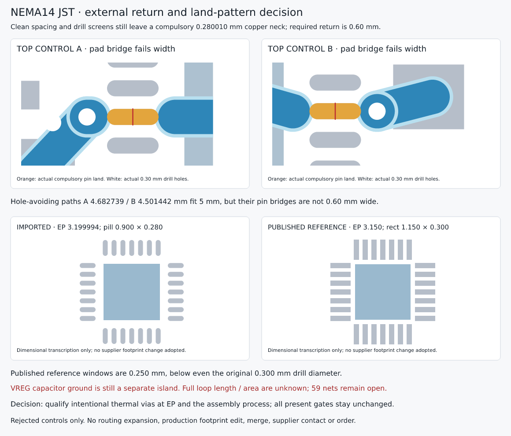

# NEMA14 JST external-star decision

**Stop the placement/routing sweep.** Two bounded external controls can connect the sense-resistor grounds to EP and clear the original drill screen, but both require an intermediate **0.280010mm ground land**, so they do not retain the required0.60mm planar return. The complete manufacturer reference pattern does not solve the between-pad drill windows. A qualified design/fabrication decision is needed; no production footprint or gate changed.

The separate controls inherit731ff15 and preserve the35mm outline, screw/case envelope, selected side-facing JST, both USB poses, bottom encoder, top DNP caps, component poses, supplier pads and sensing pin/net contract. Four GND vias move; every hole remains0.30mm and every land0.55mm. The other18 via whole records and38 non-return path arrays remain exact, including the four Kelvin pickups, CP, VREG positive leg and buzzer. Prior candidates, main and original boards are untouched.

## Fitted driver and manufacturer reference

The design BOM/native source specifies **A4988SETTR-T, catalogue C38437**, the ET28-contact QFN plus EP. The official [A4988 Rev8 datasheet](https://www.allegromicro.com/-/media/files/datasheets/a4988-datasheet.pdf), pages12/18/19, calls for soldered PAD ground, external GND3/18 ties and thermal vias; its land drawing is a reference, not tooling approval. Nominal adjacent-pad spacing is at least0.20mm. The drawing was visually inspected; the isolated native dimensional fixture reproduces its dimensions without replacing the production import.

| Dimension | Imported current land pattern | Published complete reference |
| --- | --- | --- |
| EP | 3.1999936mm square | 3.15mm square |
| Peripheral land | 0.8999982×0.2800096mm pill | 1.15×0.30mm rectangle |
| Opposite-row centre separation | 4.999990mm | 4.80mm |
| Pitch | 0.500380mm | 0.50mm |
| Minimum adjacent-pad gap | 0.220370mm | 0.200000mm |
| EP/GND18 and EP/GND windows | 0.450126/0.449872mm | **0.250000mm each** |

The current pattern differs from the reference; its nominal pad spacing passes the cited minimum. This comparison is not a terminal-coverage, stencil or assembly approval. A3.15mm EP substituted alone into the imported pattern is **not the complete reference pattern**. The earlier3.019738mm EP proposal was an unsupported dimensional counterfactual, not a published land alternative.

[Allegro AN26009 Rev14](https://www.allegromicro.com/-/media/files/application-notes/an26009-soldering-methods-for-allegro-products.pdf) discusses filling vias to reduce solder loss/voiding and hidden QFN joint inspection. Its general voiding examples do not qualify this board. An exact fitted-device alternative land, stencil/fill process and board-specific thermal acceptance were not found in the examined sources. The generic wettable-flank guide was excluded because applicability to this exact ET part was not verified. Retrieved PDF hashes and page references are preserved in `manufacturer-comparison.json`; manufacturer PDFs/images are not republished.

## Two bounded external controls

The first control moves V_GA→(3.700,7.350), V_STAR_A→(4.300,7.449873), V_GB→(11.800,6.360), V_STAR_B→(10.830,6.949493). It routes two0.60mm branches through inner1, then joins EP through the actual GND18/GND lands. The second control removes those layer detours and uses top copper to the same external via locations. No autorouter runs.

| Check | Two-barrel control | Top-direct control |
| --- | --- | --- |
| Native traces / real vias | 46 /22 | 44 /22 |
| Nominal shorts / spacing findings | **0 /0** | **0 /0** |
| +20% width-stress shorts / spacing | **0 /0** | **0 /0** |
| Adjusted SMT / annular / inner-via failures | **0 /0 /0** | **0 /0 /0** |
| Combined +20% width/drill failures | **0**, minimum+0.009249mm | same |
| Minimum adjusted SMT / annular margin | **+0.008730 /+0.010000mm** | same |
| Required intermediate ground-pad width upper bound | **0.280010mm** | **0.280010mm** |
| Full-board disconnected nets | **59** | **59** |
| Native port errors / endpoint errors / style warnings | **298 /2 /4** | **298 /2 /4** |

Clean native spacing checks and0.60mm trace properties do not prove a0.60mm physical return. Removing the actual intermediate ground pad disconnects each isolated phase. The copper cross-section through the middle of that indispensable pad is only0.2800096mm, a53.33% reduction from the target; contact lenses may constrain it further. This intermediate neck is not a source/target pad or a qualified vertical barrel. No new pad exception is assumed.

Current flow is checked after subtracting **all real via holes**. A's authored series path is **5.092772mm**, including1.480000mm ground-pad access and0.283000mm of conducted barrel travel; both barrels are required, and it exceeds5mm. B's apparent5.577702mm serial route is **bypassed by actual top copper**; neither barrel is required, so it is not reported as B's true current path.

The top-direct control deliberately removes that ambiguity. Explicit hole-avoiding paths along real annuli are **4.682739 /4.501442mm**, with zero conducted vertical barrels and pad access included. They are conductive paths inside the measured copper, **not0.60mm-wide qualifying returns**. Thus improving length does not remove the indispensable narrow pad. Neither control is promoted.

The full native checker retains two dangling-start errors at RETURN_A_EP(5.840,7.449873) and RETURN_B_EP(9.360,6.949493). Independent geometry confirms end-cap/pad overlap, but no check or endpoint error is suppressed. The exact objects and source owners are in `decision.json`. The top-direct control additionally loses six unused via-port net annotations in native source metadata; fitted part pins and explicit physical via GND nets remain unchanged, with every delta enumerated.

## Independent loop, sensing and mechanical checks

- All four real inline-shunt pad cuts still pass, with zero shared winding/Kelvin copper outside the pickup pads. Both prospective low-side paths reach EP and externally tie GND3/18, without substituting internal chip connections. The ceramic/bulk supply-return grounds remain on separate islands from EP, so a completed motor-current return loop is not claimed.
- The VREG positive leg remains0.990775mm, but **C_VREG.pin2 is a separate ground island**. No complete VREG decoupling copper loop exists; its length and area are recorded as **null**, not fabricated estimates. Ground-pad-to-EP edge separation alone is1.850131mm. The short positive-leg native pass does not qualify decoupling.
- Both CP legs retain drilled-copper continuity and stressed clearance to true EP, native square keepout and actual screw circle. The VCP reservoir-to-driver and reservoir-to-VBB connections remain open; the complete charge-pump supply system is not qualified.
- Buzzer branch continuity is independently rechecked, including rejection when either supply barrel is removed. External flyback wire travel is **13.324631mm**; external switch wire plus conducted barrels is **35.399209mm**. These are unchanged branch sums, excluding internal device/winding paths.
- Every fitted component pose/CAD placement and supplier pad is unchanged. Both native and independent copper checks retain all four screw exclusions and board edge clearances. Prior supplier-body fit bounds therefore remain applicable; no physical assembly/handling test is claimed. The moved V_GB has a new conservative bounding projection under R_SB, requiring explicit fill/mask/planarity and assembly review; this is not a measured solid collision. There are no copper pours or via drill centres inside EP in these diagnostic outputs, so board-specific thermal performance remains unqualified.

## Source-supported alternatives and decision

The complete published reference's0.25mm windows cannot fit a0.30mm hole even before the retained0.115mm radial budget. Its0.30mm peripheral lands also do not provide a continuous0.60mm external return neck. It is a source-backed land-pattern reference, **not a drop-in solution** to these constraints.

The source-backed direction to qualify is **intentional thermal vias at EP**, with a reviewed land/stencil and solder-voiding process. It requires an explicit design/fabrication decision about intentional own-ground via-in-pad handling. The current all-SMT hole rule and native prohibition would still reject it; neither is reinterpreted or changed here. Foreign-net clearances,0.30mm drills, return width and total budget remain requirements. Specific via fill/cap/planarity, actual drill/registration tolerances, solder contact/voiding, stencil/reflow, electrical/X-ray inspection, CAM and board thermal/current performance need qualification before adoption. No supplier is contacted.

**Recommendation:** freeze further placement/routing experiments and decide whether to qualify that intentional EP-via process. Do not force an unsupported EP trim or accept a narrow ground-pin bridge. If every present gate remains fixed, these studied alternatives remain rejected.

## Native entry point and evidence

Native CLI source generation passes for both separate TSX entries in **9.764s /9.218s**, with routing disabled and the documented temporary schematic-drawing control; normal configuration restores exactly. CLI/API physical/source geometry matches, with32/28 missing nonphysical CLI terminal annotations explicitly listed. All selected geometry/thickness checks pass; the full native endpoint/connectivity errors above remain.

Fresh native replay, rejection controls and typecheck pass locally. Controls reject driver-EP edits, real pin-net changes, CP copper edits, return-width changes, false VREG length cache, native length-limit changes and board-clearance changes. The isolated reference fixture is freshly replayed. The preceding VREG comparison regression also passes. The guard verifies the rejection state; it does not clear fabrication gates. Production/locality source is unchanged.

No further bounded routing runs because physical width, native endpoint, full-loop and locality gates fail. Main, original boards, prior candidates and the accepted source remain untouched; draft only, no merge/order/outreach.

Reproduce after the frozen install and geometry requirements with `python3 experiments/external-star/expand-artifacts.py`, `python3 experiments/external-star/test.py`, `python3 experiments/external-star/cli-verify.py` and `python3 experiments/external-star/compare-cli.py`. The guard validates known rejections; it is not a fabrication pass. Manufacturer source URLs/hashes are archived; PDFs remain external references.
