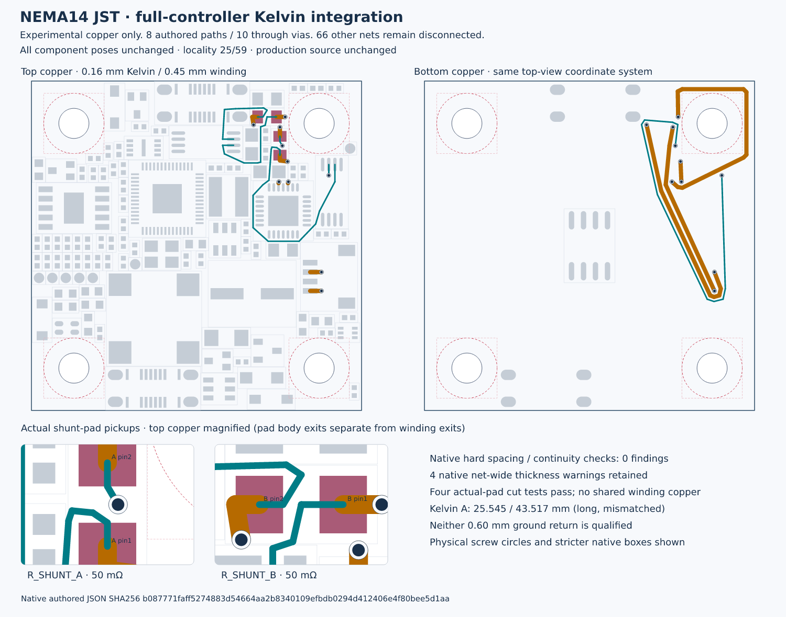

The full-controller NEMA14 JST experiment now carries all four Kelvin paths and their four winding-current branches. Normal native routing preserves all eight authored geometries. **The candidate is rejected: native full routing fails, 66 nets remain disconnected, and locality is unchanged at 25/59.** The accepted controller, placement JSON, native source artifact, original boards and production entry point are unchanged.

[NEMA14 JST measured report](../artifacts/iteration-3/report.json) · [NEMA14 JST copper verification](../artifacts/iteration-3/verification.json) · [NEMA14 JST experimental TSX](../experiments/integrated/candidate.tsx)



The experiment starts from public draft head `8b7dd84`. It retains all 102 component poses, all 375 ports, the supplier pad geometry, CAD transforms, the 35 × 35 mm board, both USB poses, the side-facing JST, the bottom DNP encoder and every mounting hole and screw reserve. All intended fitted parts stay on top. The new wrapper only authors paths on existing named source traces; it does not change the electrical terminal/net matrix or either INA240 ADC channel. Four radius 3.2 mm screw circles and the native conservative square exclusions, with the existing 0.15 mm copper clearance, are respected. The production locality, width, mechanical and clearance gates remain enabled.

Native routing-disabled generation was checked before routing. Each Kelvin spine passes the **actual body-facing edge of its inline 50 mΩ shunt pad**. All four branches physically join their actual INA240 input terminals. Removing the real shunt pad separates the amplifier from the winding branch in each case; shared winding/Kelvin copper outside the actual pad measures zero. This uses physical polygons and barrels, not branch names as connectivity evidence. The four winding paths reach the real driver/JST terminals. Kelvin wires are 0.16 mm throughout; winding wires are 0.45 mm throughout. Ten physical vias have 0.45/0.30 mm pad/drill and span all four layers. No partial-span inner-layer vias or narrowed winding necks are accepted.

The first integration had clipped driver-pad endpoints and copper within the native screw boxes. The final corridor comparison uses the rounded physical driver-pad tips, proper native endpoint continuity, a bottom-layer Kelvin branch and different winding corridors. The final eight-path copper has zero findings in the selected native hard spacing, via-in-pad, keepout, board-edge and continuity checks. Independent checks find zero shorts, pad/trace/via clearances, drill-spacing, hole/trace, board-edge or physical screw-reserve findings. This is a partial-copper result, not full-board routed DRC. The native net-wide width checker still emits four warnings comparing intentional 0.16 mm Kelvin wires against 0.45 mm winding requests on the same nets. Those warnings are retained; the verifier separately measures each actual named route. Driver pad-tip joints need manufacturing tolerance review, even though native continuity and independent polygon contact pass.

Normal CLI generation uses the original configuration, full schematic generation and the standard native router. The router sees 70 connections, 875 obstacles and four preloaded net groups. It stops after about 20 seconds of routing at a static reachability precheck on **V3V3, U_DRV.MS3 → U_DRV.RESET_N**. CLI exits 1 after 235.909 seconds including generation. Eight traces and ten vias survive; every copper coordinate, layer, width and transition is unchanged. Only native endpoint-port annotations are ignored in the equality comparison. Re-running all native routing checks reports 324 port-connectivity errors and the four width warnings. The generated board also retains the autorouting error. Independent connectivity finds **66 disconnected nets**. The routing-disabled placement screen passes 101 top courtyards; the normal-attempt placement command correctly fails because it includes native routing errors, despite zero placement findings.

| Authored path | Actual wire centerline sum |
| --- | ---: |
| POWER_A_DRV / POWER_A_COIL | 3.685 / 20.756 mm |
| POWER_B_DRV / POWER_B_COIL | 26.895 / 25.705 mm |
| KELVIN_A_POS / KELVIN_A_NEG | 25.545 / 43.517 mm |
| KELVIN_B_POS / KELVIN_B_NEG | 12.321 / 10.307 mm |

Via barrel lengths are excluded. These are not complete closed-loop lengths, inductance estimates or qualified current paths. The A Kelvin wire mismatch is 17.972 mm; B is 2.014 mm. The long winding and sensing detours are material limitations. This pass establishes native integration and preservation; it does not establish acceptable ADC noise, switching loops or electrical locality.

The previous compact-driver failure was reduced to a frozen diagnostic containing seven traces, five vias and six pads. It reproduces **all 12 original independent clearance segment findings exactly**, with zero shorts. Its native checks reproduce the approximately 0.094/0.131 mm trace-spacing failures and the RESET_N via-in-pad problem. The previous source and placement are unchanged. This is failure reproduction, not another bottom-component study.

Two bounded native SRJ corridor comparisons retain all 425 original obstacles and nine driver connections. The first uses a stricter 0.20 mm routing target; the board's 0.15 mm acceptance rule remains unchanged. It solves in 26.847 seconds and removes the trace-spacing and via-in-pad failures. Independent findings fall **12 → 2**, both at C_VCP.pin1 against VBB copper, with minimum clearance 0.060799 mm. It still fails. Adding a 0.12 mm virtual forbidden border around that pad solves in 24.741 seconds but moves conflicts to other copper: four independent findings remain, including 0.036663 mm near U_BUCK.VIN. Neither comparison is accepted. No hard shorts are found in either; both leave 64 full-board nets disconnected. SENSE1/SENSE2 wire sums are 2.025/1.974 mm versus the previous 2.013/2.056 mm; these are not closed-loop comparisons. SRJ materialization does not carry the previous authored ground returns, and externally connected point declarations do not create copper. Both actual ground-return continuity checks therefore remain false.

The fresh full-controller return probe reserves 0.60 mm width and screens actual pad/trace/via copper, drills, the board edge and all screw exclusions. Bottom-layer endpoint trials find no corridor within the tested geometry. Inner-layer reservations are possible, but the shortest tested source-pad-center-to-EP landing sums are **6.524 mm and 14.261 mm**, above the unchanged 5 mm engineering target. R_SB's actual pad-edge-to-EP lower bound alone is **9.622757 mm**, so fixed R_SB placement cannot meet 5 mm regardless of routing. These reservations are not physical traces or qualified through-vias. Neither return is verified. This is not proof that a different top-side placement is impossible.

The return target and 0.60 mm width are engineering gates, not numerical Allegro requirements. [Allegro's application layout, page 12](https://www.allegromicro.com/-/media/files/datasheets/a4988-datasheet.pdf#page=12) calls for a nearby star ground, short sense paths and thick low-impedance sense-resistor ground connections, with ceramic supply bypass closer than bulk. [TI's layout guidance, page 24](https://www.ti.com/lit/ds/symlink/ina240.pdf#page=24) explains how shared high-current impedance introduces sensing error and recommends Kelvin pickup. The pad-cut tests cover that pickup condition, not the complete electrical quality of these long routes.

The earlier generation bounds were too short. Instrumented local-asset import takes about 15.8 ms; the captured profile observes no fetch. The stall is in synchronous schematic trace rendering. A replay of the exact captured solver input remains in `inlineNetLabelSolver` at 60 seconds, without solver failure. An unchanged full `controller.tsx --routing-disabled --profile` retry completes at **210.856 seconds**, exit 0, with pinned local assets and original configuration. The cleaned public experimental entry completes at **214.179 seconds**, exit 0, with identical source/PCB/copper data to the pre-routing snapshot. This points to CPU-bound label refinement; it does not prove an infinite hang or guarantee that all future builds avoid network access. Existing schematic drawing-area and testpoint metadata warnings are retained.

From `studies/nema14-jst`, with the committed Bun dependencies and `requirements-geometry.txt` installed:

```sh
npm run typecheck
npm run test:copper
npm run test:integration
XDG_CONFIG_HOME=.config tsci build experiments/integrated/candidate.tsx --routing-disabled --profile
# Bounded diagnostic only; expected to fail full routing:
XDG_CONFIG_HOME=.config tsci build experiments/integrated/candidate.tsx --autorouter-timeout 60s --profile
# Small frozen failure reproduction:
python3 experiments/integrated/reproduce-clearances.py
# Fresh 0.60 mm corridor screen, not routed copper:
python3 experiments/integrated/probe-ground.py
# Optional exact captured schematic replay (60-second solver bound):
bun experiments/integrated/replay-schematic.ts
```

`test:integration` checks the committed experiment's physical pickup, exact preservation, unchanged geometry, widths and retained failures. Passing this regression does not accept the board. CI runs it before the unchanged blocking production locality gate. Typecheck covers the new TSX and diagnostic scripts; all 14 existing independent copper regressions and four new integration guards pass locally. Native snapshots retain evaluator-relative CAD URLs; rebuilding the TSX resolves the repository's local assets. Only URL metadata is excluded when comparing CAD transforms.

No new solid-CAD fit calculation was completed here: CadQuery is unavailable in this environment. The unchanged component/model transforms preserve the earlier conservative catalog plug, withdrawal, service and screw-envelope results. Actual connector mating, tolerances, rear motor/magnet clearance, driver thermal performance, USB ground-reference continuity/impedance, CAM and hardware remain unverified. Production `npm run autoroute` still stops at the unchanged locality gate. No candidate has been promoted, merged or ordered.
