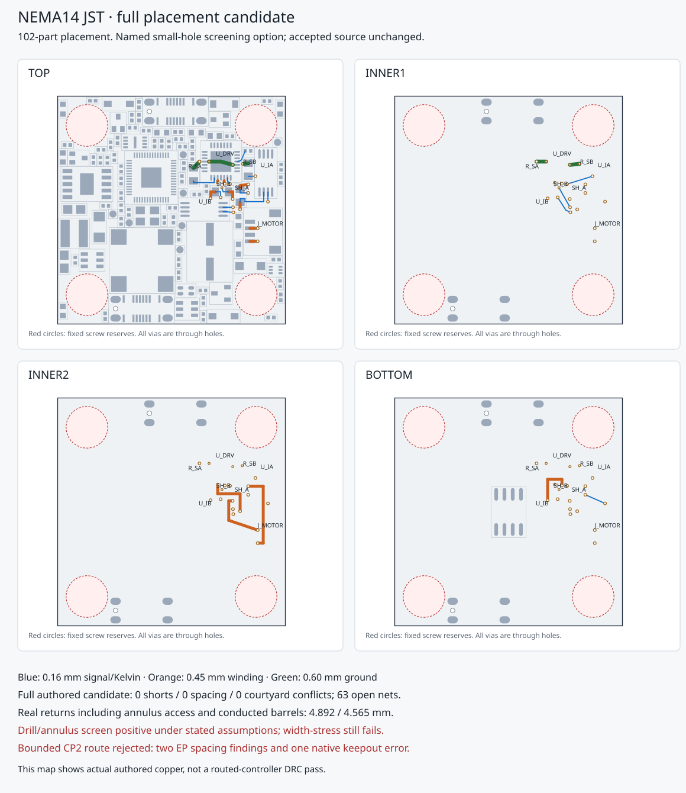

# NEMA14 JST: clean full placement and CP1 corridor

The separate TSX candidate now places all 102 parts, retains all 101 top-side supplier courtyards, and has **zero independent copper shorts, spacing findings or courtyard conflicts**. The 39 former spacing findings and 42 courtyard overlaps are removed. Locality improves **41→43/59 with every previous pass retained**. The accepted controller remains unchanged at 25/59; this candidate is not promoted.

The 35 × 35 mm outline, both USB poses, side-facing JST, bottom encoder, top DNP capacitor poses and all four physical screw reserves are fixed. All intended fitted assembly remains top-side. The complete fitted pin-to-net contract, including both shunts and INA240 ADC channels, is unchanged. Main, original boards and NEMA14 WAGO are untouched.

## Placement by actual component and net

`artifacts/iteration-7/collision-groups.json` groups every former finding by its actual unplaced part and terminal net. The 39 findings include 33 shorts and involve 26 unplaced parts:

| Function | Parts involved in copper collisions | Principal nets |
| --- | --- | --- |
| PD | R_PD, R_PG, R_PD_CFG | PD_VBUS, PD_VHV, PD_GOOD, PD_CFG, GND |
| Flash/boot | R_FLASH_CS, R_BOOT | QSPI_SS, BOOT_PAD, V3V3 |
| USB sensing | R_CC1, R_USB_SENSE_H, R_USB_SENSE_L | DATA_CC1, DATA_VBUS, DATA_PRESENT, GND |
| Motor supply sensing | R_VM_H | PD_VBUS, VM_SENSE |
| Driver controls/reference | R_REF_H, R_SLEEP | VREF, V3V3, SLEEP, GND |
| Indicators | D_STATUS, R_STATUS_R, R_STATUS_G, R_STATUS_B | DATA_VBUS, STATUS_R/G/B_K, STATUS_R/G/B_C |
| Buzzer | D_BUZZER, Q_BUZZER, C_BUZZER, R_BUZZER_PD | BUZZER_SINK, BUZZER_GATE, V3V3, GND |
| Temperature | R_TEMP_SDA, R_TEMP_SCL | TEMP_SDA, TEMP_SCL, V3V3 |
| Buck bootstrap | C_BOOTSTRAP | BUCK_BST, BUCK_SW |
| Debug pads | TP_BOOT, TP_RUN, TP_SWCLK, TP_GND | BOOT_PAD, RUN, SWCLK, GND |

Courtyard checking also identifies R_RUN, R_VM_L, TP_3V3 and Q_STATUS_B conflicts that copper-only checking misses. The final candidate explicitly relocates **46 parts** around the unchanged driver/shunt/INA cluster. `poses.json` records the complete placement; `moved-names.json` limits applied overrides to actual moves, preserving inherited locked poses exactly.

A new discrete-domain planner filters actual transformed supplier courtyards against fixed parts, real screw circles and fixed foreign copper before solving. A restricted solve shows D_BUZZER, Q_BUZZER and Q_STATUS_B competing for the same remaining pocket; it is not an all-top impossibility proof. Additional internal freedom produces a candidate. The first native replay exposes a microscopic courtyard overlap and a lost temperature bypass target. A second bounded placement solve adds 8 µm rounding guards on each courtyard side and explicit preservation of prior locality passes. The final native geometry passes both checks, without footprint edits, bottom-side moves or reduced clearances.

The optional planner uses `requirements-placement.txt`; normal native verification uses the existing geometry requirements. No board toolchain dependencies or upstream code are changed. Existing plural-path evidence is reused.

## Full placement screen

| Check | Previous full compact candidate | Final full authored candidate |
| --- | ---: | ---: |
| Copper shorts | 33 | **0** |
| Copper spacing findings, including shorts | 39 | **0** |
| Top courtyard overlaps | 42 | **0** |
| Courtyard screw/boundary conflicts | — | **0 / 0** |
| Drill, hole/trace, copper-edge, physical screw intrusions | — | **0** |
| Locality passes | 41/59 | **43/59**, no regressed pass |
| Actual authored copper | 32 traces / 20 vias | **33 traces / 20 vias** |
| Full candidate open nets | 64 | **63**, after authored CP1 |

Both bootstrap targets now pass: the capacitor is placed beside the actual buck BST/SW pins. The 16 remaining locality failures are retained as blockers. A clean placement is not routed DRC or electrical-loop qualification.

The catalog body check covers **68 moved supplier bodies**, with minimum screw-projection clearance **0.300 mm** and catalog seated/withdrawal/service-envelope clearance **0.900 mm**. These are smaller than the previous 0.526/1.985 mm margins, but remain positive. Six moved bare-pad testpoints have no fitted supplier body; their courtyards remain included in the 101-part top-side screen. No fresh STEP-kernel, physical fastener, motor/magnet, plug mating or cable-handling qualification is claimed.

## Actual CP1 corridor and ground returns

The two saved CP1 violations reproduce independently at **0.149092703 / 0.115306862 mm**, against the unchanged 0.15 mm rule. The diagnostic B-return source via moves down **0.10 mm**, and the B-positive Kelvin source via moves down **0.05 mm** to fix its drill-to-SMT tolerance deficit. Every path is regenerated from actual transformed pad anchors; no previous world-copper coordinates are substituted.

An explicit native CP1 path now exits through the measured opening. Its actual wire width is 0.16 mm, wire length **2.217847 mm**, and minimum foreign-copper clearance **0.175962 mm**. All four real shunt-pad removal tests still pass. Kelvin legs remain 0.16 mm and winding legs 0.45 mm, with no shared winding copper outside the actual shunt pads.

The two actual 0.60 mm phase returns are independently connected using only their own three wires, two real annular barrels, ground-side sense-resistor pad and EP. Removing either barrel or narrowing either return fails. Drilled holes are subtracted from planar copper.

| Phase | Actual planar wire | Annulus access | Conducted barrels | Total in the named nominal stack | With 0.160 mm depth bound per transition |
| --- | ---: | ---: | ---: | ---: | ---: |
| A | 4.608754 mm | 0 | 0.283 mm | **4.891754 mm** | 4.928754 mm |
| B | 4.081926 mm | 0.200 mm | 0.283 mm | **4.564926 mm** | 4.601926 mm |

The unchanged target is 5 mm. The existing JLC04161H-2116 screening stack uses top-to-inner1 finished copper-center depth 0.1415 mm. Finished stack tolerances and the 0.160 mm engineering bound remain unconfirmed. Via stubs below the conducted layer are not counted as series return travel. See the [earlier NEMA14 JST process evidence](anchored-copper-and-fixed-paths.md) and [published stack table](https://jlcpcb.com/impedance).

## Clearly separate process comparison

Default `process="locked"` retains the original 0.30 mm hole rule and fails the measured drill/annulus screen. Its four compact annuli have approximately **−0.040 mm** remaining radial budget; one inner-via rule also fails. It cannot enable the bounded native stage.

The explicit `process="small-hole-screen"` option retains the named ENIG / mechanical-through / epoxy-filled-and-copper-capped model: four 0.20/0.45 mm hole/pad vias and sixteen 0.30/0.55 mm vias. This is a reversible diagnostic option; production minimum holes remain 0.30 mm. Published position tolerance ±0.075 mm is combined with explicitly assumed hole-diameter growth +0.050 mm and additional copper registration 0.015 mm, giving a 0.115 mm radial budget. These extra budgets are not supplier guarantees. [Via hole size has no specified tolerance in the published covering guidance](https://jlcpcb.com/help/article/pcb-via-covering); generic PTH size tolerance is not applied to vias.

All 20 comparison vias now have positive assumption-adjusted drill-to-SMT and annular margins. Minimum margins are **+0.009936 / +0.010000 mm**. Separate adjusted 0.20 mm inner-via and 0.30 mm component-PTH rules pass. The native CP2 stage adds no vias, preserving these measurements.

This is not fabrication acceptance: **11** spacing findings remain under +20% width stress on the authored candidate, increasing to **17** after the failed automatic CP2 route. The unchanged 0.30 mm star-hole option requires a roughly 0.530 mm row slot under the same assumptions; the fixed supplier geometry offers approximately 0.450 mm. Four smaller filled/capped holes, or moving those transitions outside the narrow slots, remains a specific process/layout decision for a later candidate. No supplier is selected and no order is placed. [Capability reference](https://jlcpcb.com/capabilities/Capabilities).

## One gated native CP2 stage: rejected

Only after the full placement, drill/annulus option, source pin contract, previous locality passes and both real returns passed did `bounded-stage-preflight.json` enable one CP2 diagnostic. Runtime source hashes and actual native component poses are checked again inside the native adapter. The user entry point was tested directly:

```sh
XDG_CONFIG_HOME=.config tsci build experiments/placement/native-entry.tsx \
  --disable-parts-engine \
  --inject-props '{"process":"small-hole-screen","net":"CP2","out":"artifacts/iteration-7/native-CP2"}'
```

Pinned Core 0.0.2110 / router 0.0.958 receives the full board's native obstacles and one CP2 net. It reports solved in **20.314783 s** within the nominal 45 s stepping budget. No aggregate router or new singular/plural A/B is run.

All **33 authored trace records and 20 via records remain byte-equivalent**, with serialized-record SHA-256 `6837741394bddbb4b9b30266e23f7588ee6752d31bb87bf2fb674869d153dec0`. The four real shunt pickups and both wide returns still pass. The native result has **34 traces / 20 vias**, with CP2 connected and **62 full-board open nets**.

**The CLI exits 1 and the output is rejected.** Independent checks find two CP2-to-EP gaps of **0.120894 / 0.119332 mm**, required 0.15 mm. Native checks report **313 port errors, one pad/trace clearance error, and one keepout trace error**. Actual widths are checked; native thickness warnings remain zero.

The native keepout error is **0.089998 mm** to the upper-right keepout's axis-aligned bounding box, required 0.15 mm. The independently measured physical radius-3.2 mm circle clearance is **0.317135 mm**. Pinned `checkEachPcbTraceNonOverlapping` applies `segmentToBoundsMinDistance(getCollidableBounds(obj))` to these keepouts. Both measurements are retained; the native error is not suppressed and no keepout is shrunk. A later CP2 corridor must also respect the native box: with its lower edge at y=9.8, a 0.16 mm top wire must stay at or below **y=9.57**, while clearing the real EP by 0.15 mm.

## Remaining electrical tradeoffs and verification

The all-top packing still leaves poor auxiliary buzzer placement. `placement-tradeoffs.json` reports real pin-distance proxies, not routed loops. The flyback diode-to-buzzer pin L1 proxy worsens **20.629568→38.332529 mm**, and the buzzer capacitor-to-supply proxy **8.784089→13.460267 mm**. These are placement distances, not routed loop lengths. Both need further clustering before promotion. The two supplies/returns, USB reference path, thermal/current capacity, complete CAM and assembly remain unqualified. Zero placement conflicts is not proof these loops can be routed acceptably within the locked envelope.

`python3 experiments/placement/test.py` replays the actual full TSX, compares physical/source arrays, and checks all courtyards, pin contracts, real pad cuts and barrel-inclusive returns. It rejects a new courtyard overlap, current-sense net corruption, and one-ULP fixed-copper mutations. It retains the actual failed CP2 and manufacturing controls. The new CI guard runs before the unchanged production locality gate. The legacy accepted source remains untouched.

Large native JSON and planner domains are losslessly compressed. Run `python3 experiments/placement/expand-artifacts.py` from this study directory to verify hashes and restore exact bytes for manual replay. The regression reads compressed saved evidence directly. No Core, router, checker, original board, manufacturing rule or upstream PR is modified.


