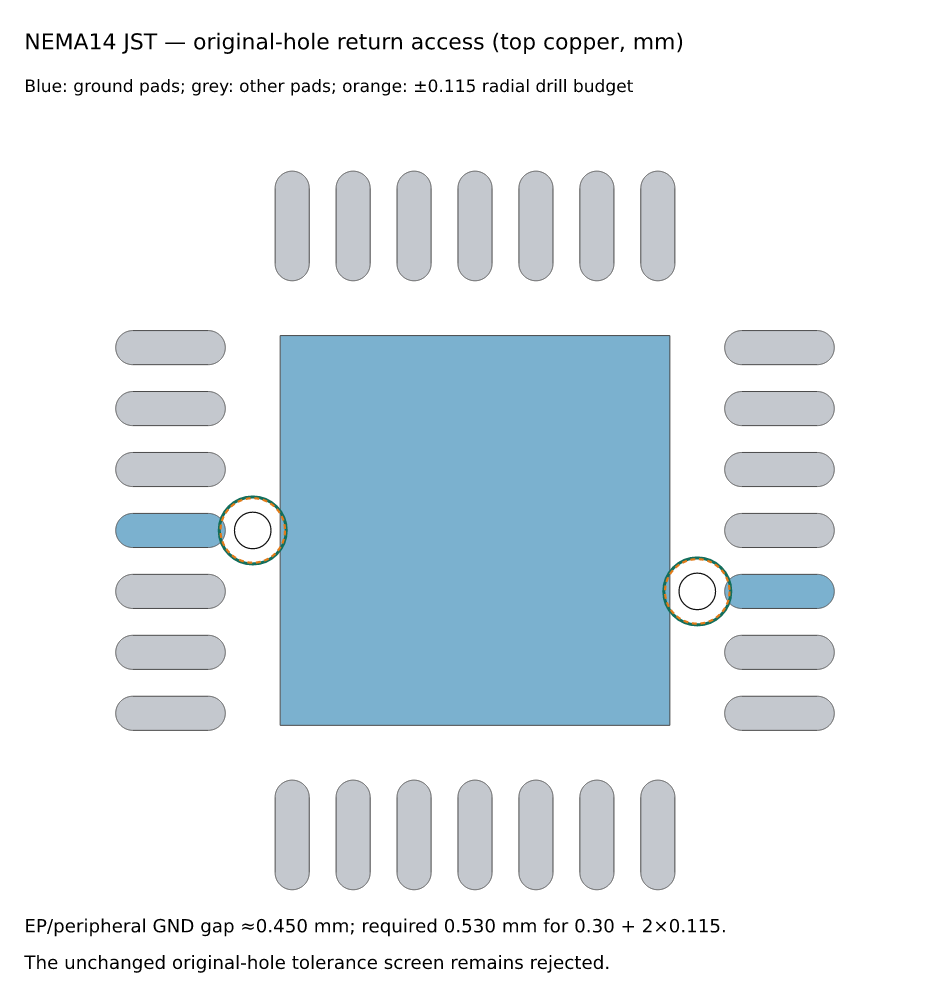

# NEMA14 JST original-hole comparison

Separate experiment from c978b75; accepted controller, earlier candidates, main and originals are unchanged. This is **not promoted or fabrication ready**. No native routing expansion occurred: the remaining original-hole and VREG gates still block it.

| Measurement | c978b75 comparison | Original-hole experiment |
| --- | --- | --- |
| Full +20% width stress shorts / spacing | 0 / 11 | **0 / 0** |
| Inherited combined width/drill failed pairs | 3 | **0**; minimum full-board margin **+0.009248786 mm** |
| Original-hole adjusted SMT / annular / inner-via failures | 3 / 4 / 1 | **2 / 0 / 0** |
| Nominal shorts / spacing / courtyard conflicts | 0 / 0 / 0 | **0 / 0 / 0**, 101 top courtyards |
| Actual traces / vias / open nets | 44 / 22 / 59 | **44 / 22 / 59** |
| Candidate locality | 43/59 | **43/59**, every row exact |
| Native port errors / length errors / style warnings | 300 / 1 / 4 | **300 / 1 / 4**, retained |

Every component pose is exact, including both USBs, side-facing JST, bottom encoder, top DNP capacitors, 35 mm outline and four screw reserves. Thirty-three trace route arrays, including all Kelvin, charge-pump and buzzer arrays, are exact. Eleven intentional local path changes and two moved vias are enumerated in the audit. All 22 holes are **0.30 mm**, all lands **0.55 mm**: four former 0.45 mm lands enlarge by0.10mm to provide0.125mm nominal annulus and **+0.010mm** residual under the existing0.115mm radial budget. This is screening, not a supplier annulus guarantee or current-capacity result.

## Exact inherited causes

The 11 stress findings are owned in `audit.json`, including every equal-distance matching segment and the duplicate zero-length return nodes. All nominal gaps pass0.15mm; positive width growth creates the failures:

- Four driver-pad pairs: POWER_A_DRV__2 against SENSE1/NC25; POWER_B_DRV__2 against SENSE2/NC25. Nominal gap0.154597→stressed0.109598mm. Their 0.45mm end caps originally reached the outward pad tips. Retract each endpoint0.160mm while retaining physical end-cap/pad overlap **0.008862245mm²**. The TSX endpoint binder checks actual stroke contact before assigning terminal metadata; an independent polygon check verifies that contact. No source connection is removed.
- Five findings at the two wide star-return ends: RETURN_A_EP against DIR/REF; RETURN_B_EP against CP1/ENABLE_N, with two distinct ENABLE_N segment findings. Nominal gaps about0.1793→0.1193mm. Start each 0.60mm wire0.25mm toward EP on the real via annulus. All drilled holes are subtracted when proving phase-only continuity. Annulus-to-axis travel remains in the5mm metric.
- One POWER_B_DRV__0/C_VM.pin2 pair:0.154998→0.109998mm. Shift the power column6.025→6.090mm, preserving the body-facing shunt branch and opposite-edge Kelvin pickup.
- One POWER_B_DRV__2/AUTHORED_SENSE_B__2 pair:0.195380→0.134380mm. The same driver endpoint correction restores it without moving the sense pin or shunt pickup.

The three inherited combined pairs are different object pairs from those11: POWER_A_DRV__1–V_KBN_S and POWER_B_COIL__1–V_KBP_T on inner2, each−0.035mm; AUTHORED_SENSE_A–V_PA_D on top,−0.010198mm. The first power corridor now passes between the actual V_KBN_S and V_KBP_S holes; the second uses x8.700mm; the sense bend moves6.549367→6.500mm. The audit checks each segment against every foreign-net via on its real layer under **+20% width +0.115mm radial budget +0.20mm hole-to-track rule**. The inner rule remains separately checked.

Restoring the KBN hole to0.30mm exposed an additional driver-tip drill conflict during qualification. V_PB_D moves(8.200,4.050)→(8.100,4.125), with both adjoining actual paths regenerated; V_GB moves(10.885,7.099998)→(10.830,7.000). Rejected intermediate comparisons are retained locally, not promoted. No old coordinates are reused after moving these two vias.

## Preserved physical sensing and returns

All four actual shunt-pad removal tests pass: the pad is necessary for each pickup, and Kelvin and winding copper share zero area outside the actual pad. Each return is independently connected using only its source pad, three wires, two real annuli/barrels and EP, after subtracting **all real holes**; removing either barrel breaks it. Both actual wire widths remain0.60mm.

| Return | Planar wire | Annulus access | Two conducted barrels | Total | Upper-depth total |
| --- | --- | --- | --- | --- | --- |
| A | 4.358754 | 0.250000 | 0.283000 | **4.891754mm** | **4.928754mm** |
| B | 4.019642 | 0.450000 | 0.283000 | **4.752642mm** | **4.789642mm** |

B grows from4.564926mm by0.187716mm, retaining positive5mm margin. The helper now derives access from both actual via axes for every comparison; clipping cannot shorten the reported return artificially. The named JLC04161H-2116 four-layer/1.6mm screening stack is unchanged; finished stack tolerances, barrel current/thermal behavior and procurement acceptance remain unverified. `wire-lengths.json` compares the other explicit power and Kelvin branches and states its travel exclusions.

## Original-hole blocker, measured

The remaining failed pairs are **V_STAR_A (pcb_via_15)** to **U_DRV.EP (pcb_smtpad_195)** and **GND18 (pcb_smtpad_206)**; and **V_STAR_B (pcb_via_17)** to **EP** and **GND (pcb_smtpad_221)**. Their minimum nominal drill-edge/SMT gaps are **0.07506305 /0.07493605mm**. Position-only margins are **+0.00006305 /−0.00006395mm**; the existing combined budget gives **−0.03993695 /−0.04006395mm**. These same-net SMT gaps are a separate project screen from foreign-net clearance. Native via-in-pad checks pass nominally; they do not validate tolerance-adjusted clearance.

The actual EP/peripheral-pad gaps are **0.4501261 /0.4498721mm**. A0.30mm hole plus two0.115mm budgets needs **0.530mm**: about **0.080mm more space**. The existing vias already sit at the best local midpoint, so recentering cannot fix this bound. Even ideal local geometry permits at most **0.2201261 /0.2198721mm holes** at zero residual margin under this screen.

An optimistic full top-pad domain test uses the stressed0.72mm return, unchanged0.15mm foreign-pad clearance, all-SMT drill budget and full outer-radius annular access. The EP trace region is closed by foreign-pad buffers. It finds zero reachable original-hole via-centre area for lands0.55–4.00mm at11 sampled sizes, repeated at128/256 curve subdivisions. This is a bounded geometric result, not proof over every footprint/process imaginable. Additional copper or layer obstacles cannot help that pad-only test. Increasing the land alone is not a demonstrated solution.

The smallest remaining decision concerns a qualified via process/footprint treatment: smaller holes with positive verified margin, or a qualified filled/capped EP via-in-pad implementation and explicit rule handling. The latter still fails the retained all-SMT screen and native prohibition if silently enabled, so **neither option is adopted**. No footprint pad is cut, no NC pad removed, no via-in-pad flag changed and no threshold lowered.

## VREG diagnostic substantiated, unchanged

Pinned Core defines `DEFAULT_MAX_DECOUPLING_TRACE_LENGTH_MM=1` in `Capacitor_getAutomaticMaxDecouplingTraceLength`; power-to-ground topology sets capacitor `max_decoupling_trace_length`, and `getMaxLengthFromConnectedComponents` propagates it to this named trace. Its native maximum remains1mm and error remains visible. Actual wire **2.605856mm** and true pad-edge lower bound **1.366017mm** prove routing alone cannot meet1mm at the present pads. This establishes ownership and the geometric obstruction; it does not treat the default as a numeric Allegro1mm requirement or claim a global placement impossibility. No component pose or native maximum changes.

[Allegro A4988](https://www.allegromicro.com/-/media/files/datasheets/a4988-datasheet.pdf), pages10/12, requires0.22µF VREG decoupling and low-impedance star/sense returns. [JLCPCB capabilities](https://jlcpcb.com/capabilities/Capabilities) publishes±20% track width,±0.075mm hole position and0.20mm via-hole/track clearance. The additional0.025mm hole-radius growth and0.015mm registration terms are **existing engineering assumptions**, not confirmed via supplier tolerances. Generic PTH tolerances are not assigned to via drills. The unchanged gate is reported alongside this analysis.

## Native entry point and remaining gates

Pinned native CLI generation exits **0** in **9.306s**, with routing disabled and the documented schematic-drawing control; normal config restores exactly. Its physical/source geometry is exact against the independently checked API output. CLI omits the explicitly listed nonphysical endpoint annotations that the API contact binder supplies. Selected native geometry/thickness checks are all zero; all routing checks still report300 unconnected-port errors, one VREG length error and four style warnings. No checker patch, Core bump, new routing stage or routed-DRC claim.

The candidate retains16 locality failures and59 open nets. Production stays25/59 and remains the blocking CI locality gate. Original-hole star margins, VREG placement, finished stack/process acceptance, completed connectivity/routing, CAM, supplier assembly review, actual screw/plug/handling fit, thermal/current capacity and hardware validation remain open. Existing supplier-body mechanical evidence is inherited because all component poses remain exact; no new physical fit test is claimed. Main and original designs are untouched; draft only, no merge/order/outreach.



Reproduce after the frozen install and geometry requirements:

```sh
python3 experiments/original-process/expand-artifacts.py
bun experiments/original-process/render.ts .config/original-hole.circuit.json
python3 experiments/original-process/audit.py .config/original-hole.circuit.json .config/original-hole-audit.json
python3 experiments/placement/screen-process.py .config/original-hole.circuit.json .config/original-hole-process.json
python3 experiments/original-process/test.py
python3 experiments/original-process/cli-verify.py
python3 experiments/original-process/compare-cli.py
```

The replay guard validates the expected rejection state. It is not the manufacturing or locality gate; both remain blocking as reported.
