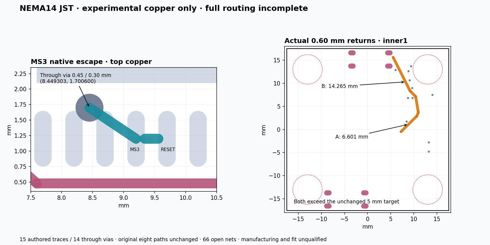

# NEMA14 JST: native escape and actual ground copper

This is an experimental TSX candidate, separate from `controller.tsx`. The accepted production placement remains 25/59 locality passes, 34 failures, zero traces and zero vias. The original boards, 35 mm outline, both USB poses, side-facing JST, bottom DNP encoder, top encoder capacitors and all four screw reserves are unchanged. No candidate is promoted; no manufacturing release is implied.

## Exact MS3 failure and physical escape

The old full-board input has 875 obstacles and 70 nets. Isolating V3V3 MS3 (`pcb_port_213`, 9.199873, 1.200005) to RESET_N (`pcb_port_214`, 9.700253, 1.200005) with all obstacles reproduces the static failure on router 0.0.958. Normalizing 90-degree rectangles to equivalent axis-aligned geometry does not fix it. The same pair with only the 64 nearby obstacles solves. This reduced comparison is diagnostic, not a legal full-board route.

The native graph attaches MS3 to two tiny dead-end pad fragments, with no legal exit after two traversed states; RESET has 14 incident ports. No foreign reservation blocks that small frontier. This points to a topology subdivision/attachment failure at MS3 in the full obstacle context, rather than a mistaken net or a physical short between the adjacent endpoints. Frozen inputs, endpoint metadata and frontier are in [NEMA14 JST diagnostic evidence](../artifacts/iteration-4/reachability/).

The exact pad-to-pad gap permits a 0.16 mm authored bridge with 0.2203704 mm exposed wire. That same-net bridge avoids asking the router to solve the failed terminal pair. A separate top configuration-space check shows the mode array in a pocket bounded by EP, VREG/ROSC and fixed Kelvin copper. EP-to-VREG is 0.4501261 mm; subtracting twice the unchanged 0.15 mm clearance leaves only 0.1501261 mm for a top trace, below 0.16 mm. **This is a top-layer result, not proof that a multilayer escape is impossible.**

The candidate therefore authors a real 0.45/0.30 mm through via at (8.449303, 1.700600), between the rounded MS1/MS2 pad ends. It and the 0.16 mm MS3 branch connect only the existing V3V3 mode array. All-layer independent copper checks include the preserved bottom Kelvin trace and new inner1 ground return. Closest foreign copper is 0.170374 mm on bottom; inner1 ground is 0.170838 mm away. The nominal drill-to-nearest SMT copper gap is only 0.024517 mm. The drill does not overlap a pad at nominal geometry, but mask, drill registration, tolerances, tenting and assembly have not been qualified. No fab-readiness claim follows from native clearance checks.

## Ground returns: copper exists, length gate still fails

The unchanged placement now has two actual 0.60 mm top stubs, real through barrels, 0.60 mm inner1 routes, and a common 0.60 mm star-to-EP stub. These are native traces, not the earlier reserved strips. Both independent width/continuity tests reach the real A4988 exposed pad. The native Via constructor on the pinned Core creates only top/bottom ports before the four-layer parent is known. `through-via.tsx` registers the missing inner ports on that same native physical barrel; it adds no pretend pad and changes no drill, copper or layer span.

| Measurement | A | B |
| --- | ---: | ---: |
| Actual source-to-star wire sum | 6.601309 mm | 14.264937 mm |
| Unchanged engineering target | 5 mm | 5 mm |
| Length acceptance | Fail | Fail |

Those lengths exclude via barrels and the common 1.775127 mm center-to-center EP stub. The unchanged R_SB pad-edge-to-EP lower bound is 9.622757 mm, already exceeding 5 mm. A bounded 0.025 mm grid screen of 32,745 centers finds 26 legal straight-stub landings on the EP right and none in its left/upper/lower search regions. The earlier left reservation would put a physical via only 0.001666 mm from bottom Kelvin copper. This screen is not a proof against every curved route or every possible all-top placement.

The A4988 [application layout, page 12](https://www.allegromicro.com/-/media/files/datasheets/a4988-datasheet.pdf#page=12) calls for low-impedance sense-resistor returns to the exposed-pad star and ceramic VBB bypass nearer than bulk. Five millimeters is our unchanged engineering target, not an Allegro numeric limit. The [INA240 layout guidance](https://www.ti.com/lit/ds/symlink/ina240.pdf#page=24) motivates separate shunt pickoffs. All four actual-pad cut checks still pass, and no winding/Kelvin copper is shared outside either shunt pad. Original long Kelvin/winding detours remain unqualified; SENSE1/2 forward paths and USB reference copper are not completed.

## Remaining driver diagnostic

The previous frozen compact-driver comparison reduced twelve independent clearance findings to two with a stricter 0.20 mm routing target while retaining the 0.15 mm acceptance gate. Both remaining conflicts are C_VCP.pin1 to the PD_VBUS branch, with 0.060799/0.102104 mm clearance. This frozen diagnostic is separate from the unchanged all-top controller candidate.

A distinct bounded experiment authors a 0.45 mm downward PD_VBUS escape from C_VCP.pin2 to a via at (5.2419413, -1.1), then reroutes the same nine-net driver scope with all 425 obstacles retained. Router 0.0.958 solves in about 27.3 s, but the translated diagnostic already contains two shorts and 17 clearance findings. Two additional unsupported route primitives are not translated; connectivity and complete DRC cannot be claimed. This is rejected, not adopted. The two prior driver conflicts therefore remain unresolved. A local top-side rearrangement also introduced physical shorts/clearances and was discarded. No bottom assembly change is adopted.

## Width-warning compatibility evidence

Before altering dependencies, the same native one-shunt TSX coupon was tested on the old pinned stack and tagged Core 0.0.2488/router 0.0.1165. Four raw native boards, SRJ inputs, physical checks and diagnostic ownership results are preserved in [NEMA14 JST compatibility evidence](../artifacts/iteration-4/compatibility/).

| Stack / mode | Actual Kelvin / power width | Old checker 0.0.242 | Checker 0.0.283 |
| --- | --- | --- | --- |
| Old / authored | 0.16 / 0.45 mm | Two false warnings owned by Kelvin traces | Zero |
| Old / automatic | 0.16 / 0.16 mm | Two real power underwidths | Same two real underwidths, correct owners |
| Tagged / authored | 0.16 / 0.45 mm | Two false ownership warnings | Zero |
| Tagged / automatic | 0.16 / 0.45 mm | Two false ownership warnings | Zero |

All four coupons independently have zero shorts, clearance findings and open nets, and both actual-shunt pad cuts pass. Only the old automatic case fails width. Tagged automatic inputs carry explicit terminal `path` arrays; tagged authored inputs preserve the four `isFixed` branches with their actual `connectsTo` pairs. This confirms the limited compatibility lead, not whole-board router compatibility.

[Core #5924](https://github.com/tscircuit/core/pull/5924), [Core #5899](https://github.com/tscircuit/core/pull/5899) and [router #4184](https://github.com/tscircuit/tscircuit-autorouter/pull/4184) supply the upstream context. The board retains Core 0.0.2110, router 0.0.958 and CLI 0.1.2261. Only checker 0.0.283 and its Circuit JSON schema 0.0.562 are adopted after a checker-only CLI control. No warnings are filtered. The old automatic coupon remains a negative regression and still generates its two genuine underwidth warnings. The historical four false net-wide warnings on the eight-path controller now disappear with correct ownership; actual width assertions remain mandatory.

## Latest full-board result

The final routing-disabled native board has 15 traces and 14 real through vias. A fresh native routing API attempt with schematic and parts-engine generation disabled completes in 50.625 s, records `aJ ran out of iterations (capacity-autorouter@0.0.958)`, and preserves all fifteen authored paths exactly. All eight original Kelvin/power paths and every original component, port, net, pad, mount and CAD pose remain identical. Independent checks report zero shorts, clearance, drill-spacing, hole, edge or screw violations, and **66 disconnected nets**.

The twelve selected native geometry/continuity/width checks each return zero. Running all native routing checks still reports **319 port-connectivity errors and eight long-segment angle/style warnings**. With the same checker, the old eight-path control reports 324 port-connectivity errors and seven style warnings. The style warnings remain visible; the one added warning belongs to the long ground return. They are distinct from the four false thickness warnings corrected by the checker update. There is also one native autorouting error in the raw board. This is not a full routed DRC pass.

The real CLI entry point was tested twice with the original configuration and full schematic generation, once normally and once with `--autorouter-debug`. Both processes were killed (exit 137) during global port-point planning after the old MS3 static failure had been bypassed. Neither emitted a new completed board. The termination cause was not established; no successful final full-CLI routing result is claimed. The API result is labeled separately and does not replace that missing verification. [NEMA14 JST measured counters and receipts](../artifacts/iteration-4/report.json) and raw logs retain both failures.

## Reproduce and limits

Use Bun 1.4.2 and the committed lock, plus the pinned geometry requirements. From this study:

```sh
bun install --frozen-lockfile
npm run typecheck
npm run test:gate
npm run test:copper
npm run test:integration
npm run test:width-ownership
npm run test:reachability
XDG_CONFIG_HOME=.config tsci build experiments/reachability/escape.tsx --autorouter-debug
```

`test:reachability` regenerates the routing-disabled native geometry, checks original footprints/ports/mounts, all eight original paths, four real pad pickoffs, actual widths/barrels and selected native checks, and compares with the saved normal-routing attempt. It deliberately records failure of full connectivity and both length targets. The production `npm run autoroute` retains its blocking locality gate.

For stack replay, install the locked `experiments/compatibility/stacks/legacy` or `tagged` control in an isolated directory. Pass that directory's absolute `node_modules` to `bun experiments/compatibility/run.ts NODE_MODULES legacy|tagged authored|automatic OUTPUT_PREFIX`; the runner rejects mismatched Core/checker/router/schema versions. The study's installed stack uses label `checker-only`. Each replay runs in a fresh process. No dependency bump is proposed beyond the checker/schema correction.

The production `npm run source:check` succeeds (exit 0) under the checker-only correction. Source/PCB records and CAD poses match the accepted board; the accepted artifact itself remains unchanged. Typecheck, six placement regressions, fourteen copper regressions, integration guards/verification, width ownership and all eight compatibility pad cuts, reachability preservation, plug and Kelvin regressions pass locally. The production electrical and placement checks pass; locality deliberately exits 1. Existing source and schematic warnings remain in the raw log.

The saved measured result and native logs are authoritative for the latest full run. Zero selected geometric errors is not routed DRC: open nets, native routing errors, ground length, driver bypass/return locality, USB reference/impedance, thermal performance, stackup, CAM, tolerances and physical mating remain gates. Existing conservative plug/withdrawal/service screens are preserved by identical component/CAD poses, but no fresh solid-fit calculation or hardware test was performed.


