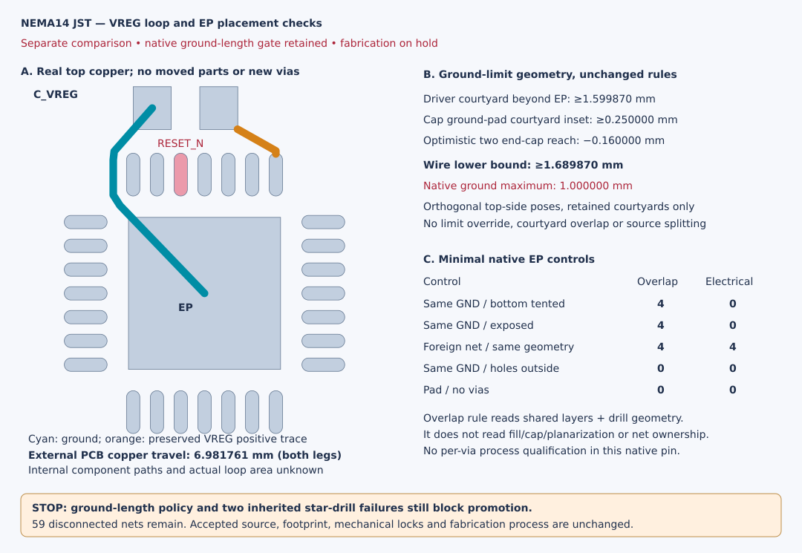

# NEMA14 JST VREG loop and native EP-via checks

**Two bounded checks are complete. A separate candidate closes the VREG capacitor's external ground connection without a new via or process assumption, but fails the unchanged native1mm ground-leg limit. The EP-via controls identify genuine drill overlap under a process-unaware placement policy. Neither result is promoted.** Accepted source, all prior candidates, main and original boards remain unchanged; fabrication and supplier contact stay on hold.

## VREG return: actual copper and complete external travel

The candidate inherits the existing all-top comparison from a01fd79. It adds **one0.16mm top trace**, with no component movement, new vias, footprint changes or other rerouting. The exact world-coordinate centreline in millimetres is:

```
(6.499976,11.350000) → (5.700000,10.440000)
→ (5.680000,10.260000) → (5.680000,9.520000)
→ (5.820000,9.300000) → (7.600127,7.449873)
```

Both endpoints are inside their actual pads: C_VREG.pin2 and U_DRV.EP. The path goes around the driver's corner rather than crossing RESET_N. It does not cross any real drill, borrow a new barrel, or share existing ground-trace copper outside EP. Existing GND3/GND18 already reach EP through the retained native copper; that does not qualify the inherited star-via drill margins. VBB ceramic-ground connectivity to EP remains incomplete.

A bounded first search used the retained0.15mm clearance and produced a4.921282mm witness with0.150164mm minimum stressed clearance. One stricter0.18mm planning comparison produced the retained **4.960966mm** trace with **0.180421mm** minimum stressed clearance to U_DRV.SLEEP (0.196421mm nominal). The board rule stays0.15mm. The0.02mm grid generates a candidate; final simplified segments are independently checked against continuous geometry. This is not a global shortest-path claim.

| Physical measurement | Before | Separate candidate |
| --- | --- | --- |
| Positive wire / full pad-centre travel | 0.990775 /2.020794mm | Exact, unchanged |
| Ground wire / full pad-centre travel | Open | **4.960966mm**, zero barrels |
| Total external PCB copper travel, both legs including pad access | Incomplete | **6.981761mm** |
| C_VREG ground and EP real copper island | Separate | Same |
| Ground copper islands | 83 | **82** |
| Full-board disconnected nets | 59 | **59**, GND still has other islands |
| Nominal / simultaneous+20% width shorts and spacing findings | 0 /0 | **0 /0** |
| All inherited trace / via whole records preserved | 44 /22 | **44 /22** |

Both external decoupling connections are verified from real native copper and logical terminals. The capacitor's1.400048mm terminal-centre span and the IC's EP-to-VREG terminal chord are **component reference geometry, not measured internal current paths**. Closing those two chords gives an8.531634mm² projected reference polygon; it is not the actual silicon/capacitor loop area or an inductance measurement. Exact internal loop travel, impedance and hardware decoupling quality remain unverified. The report therefore does not confuse Core's wire span with the full external circuit.

Independent checks retain all four real inline-shunt pad-cut proofs and zero shared winding/Kelvin copper outside those pads. Sense returns remain **4.891754/4.752642mm**, including the previously measured pad access and conducted barrels. Every old route, via, fitted pose, supplier pad, CAD transform, courtyard, board boundary, USB/JST pose, encoder/DNP placement and screw reserve is exact. Portable replay ignores only local CAD asset URLs and independently verifies derived length caches within1e−12mm; copper coordinates, widths, nets, source owners and terminal records remain exact. CP and buzzer paths therefore keep their established geometry; the added ground trace is checked against them at simultaneous stressed widths.

Nominal/stressed drill-spacing, hole/trace, board-edge and physical screw findings remain zero. The simultaneous width/foreign-drill screen retains minimum **+0.009249mm** globally; the new return's minimum is **+2.727171mm**. The **two inherited all-SMT star-hole tolerance failures remain** at the original0.30mm drills. No manufacturing rule, tolerance budget or physical lock is relaxed.

## Native length gate and placement bound

The added direct two-port source owns its actual4.960966mm copper and inherits **max_length=1mm** from the pinned Core capacitor inference. That maximum is retained, and the trace-length cache is truthful. Explicit pinned routing checks report:

- API: **299 port diagnostics +1 ground-length error +4 inherited style warnings**.
- CLI export replay: **301 port diagnostics +the same1 length error +4 style warnings**.
- All selected geometry, continuity and thickness checks: zero findings.

The two extra CLI port diagnostics concern the preserved OUT1A/OUT2A endpoint annotations;26 missing nonphysical annotations are enumerated. CLI/API physical copper, source contracts and actual lengths are exact. Independent connectivity does not substitute annotations for copper.

At the current pads, even an unobstructed bridge has1.850131mm edge separation. Allowing both0.08mm trace end caps leaves an optimistic **1.690131mm wire lower bound**, already above1mm. RESET_N only makes a direct bridge worse.

A necessary geometry bound also rules out solving this particular cap-to-EP gate through a small orthogonal top-side placement change while retaining these courtyards. The rectangular driver courtyard extends at least **1.599870mm** beyond EP on every axis; the capacitor ground pad lies at least **0.250000mm** inside its own courtyard. Disjoint orthogonal rectangles must separate on one axis, so pad separation is at least1.849870mm, and optimistic wire length at least **1.689870mm** after both end caps. This bound ignores all other obstacles and so cannot be improved by routing. It is scoped to the retained footprints, non-overlapping courtyards, orthogonal rotations and top assembly; it is not a proof for every component/package/assembly technology.

The minimum deficit is **0.689870mm** even in that optimistic model. The actual retained corridor needs4.960966mm. These are measured tradeoffs, **not authorization to raise a limit or overlap a courtyard**. No source splitting, net-owner change, cached-length trick, maximum override or Core edit is used. Allegro specifies VREG ceramic decoupling and low-impedance grounding; the earlier [NEMA14 JST source review](vreg-star-comparison.md) distinguishes that guidance from Core's inferred numeric1mm rule.

The native CLI entry `tsci build experiments/loop-check/candidate.tsx --routing-disabled --disable-parts-engine` exits0 for source generation in9.318s with the documented temporary schematic-drawing control; normal config restores exactly. **That is not routed DRC:** running the explicit pinned checker on the exported circuit retains the1mm failure above. No aggregate autorouter or next routing group runs.

## Minimal native EP-via controls

One3.15mm ground pad and four0.30/0.75mm vias reproduce the four proposed EP overlaps without the rest of the controller. No fill process is approved and no allow-via-in-pad flag is set.

| Native TSX control | Drill-overlap placement findings | Electrical via/pad clearance findings |
| --- | --- | --- |
| Same GND, bottom tented | **4** | **0** |
| Same GND, exposed | **4** | **0** |
| Foreign net, same positions | **4** | **4**, genuine foreign copper conflict |
| Same GND, holes outside pad | **0** | **0** |
| Pad without vias | **0** | **0** |

Pinned checks0.0.283 `checkViasInPads` tests shared layers and `doesViaHoleOverlapPad`; it does not inspect net ownership, fill, copper cap or planarization. Core invokes it through placement checks. The module and function hashes, line reference, actual four diagnostic pairs and schema/control records are archived in `ep-controls/diagnosis.json`.

The four own-ground findings are **geometrically correct under the unchanged no-hole-in-pad policy**, not four foreign-net shorts. Physically filling/capping a via is a distinct fabrication construction. In this pin, `pcb_via` and ViaProps do not preserve proposed fill/cap/planarization fields; unknown-field parse controls strip them. Tenting affects mask representation and does not represent a filled, planar copper cap. Consequently the native model cannot selectively establish qualified filled own-ground EP structures from this manifest.

The checker has a global board skip flag, but it is neither set nor tested as a passing workaround: it would not establish per-via qualification or foreign-net insulation. No DRC is suppressed, no production Core/checker is edited, and no upstream PR is created. The [NEMA14 JST process package](ep-via-process-review.md) remains a separate unapproved fabrication proposal with selective XY/CAM requirements.

## Stop decision

Keep the new VREG trace as a **physically verified comparison**, with its native length failure explicit. Before promoting or routing further, resolve the design-rule question: **what complete external VREG loop and per-leg requirement is intended, and how should the automatic1mm ground-to-EP span be represented while preserving actual loop visibility and courtyard safety?** The existing gate remains unchanged until that decision; simply increasing it to fit this route is not justified by this result.

Separately, intentional own-ground EP vias still require process/assembly qualification and an explicit selective native representation/policy decision. Digital fill labels alone do not qualify them. Both questions are recorded; no supplier contact or fabrication action is authorized here. Complete motor/USB/supply returns, full routing/connectivity, manufacturing/CAM, thermal/current, actual fit and hardware acceptance remain open.



Reproduce with the frozen dependencies and geometry environment: expand `experiments/loop-check/expand-artifacts.py`, then run `experiments/loop-check/test.py`. The guard freshly renders native TSX, checks independent geometry, tests rejection of fake caches/rule/width/old-copper edits and replays the minimal EP controls. Native CLI replay and comparison have separate scripts. Guard success confirms both the measured improvement and the retained rejection gates, not manufacturing readiness.
