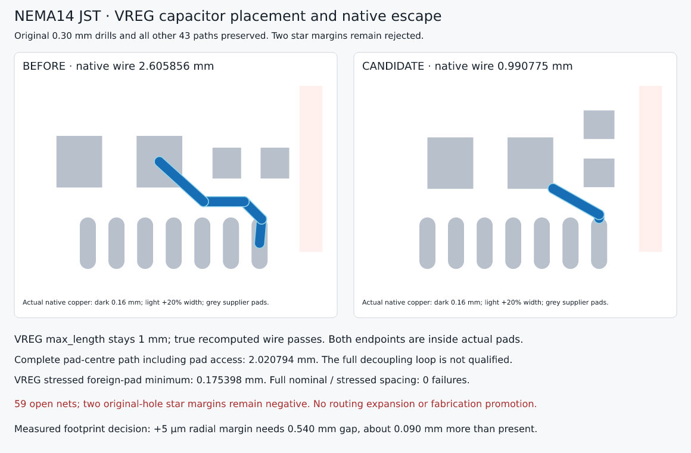

# NEMA14 JST VREG and original-hole star comparison

Separate candidate from4600e6b. **VREG's native positive-leg length gate is resolved; the two original-hole star-via tolerance failures remain blocked by the retained driver land pattern.** Accepted controller, earlier comparisons, main and original boards remain unchanged. This candidate is not promoted; no new routing stage, merge, order or outreach.

| Check | 4600e6b | Separate candidate |
| --- | --- | --- |
| VREG authored wire / native maximum | 2.605856 /1mm | **0.990775487 /1mm**, no override |
| True VREG pad-edge gap | 1.366017mm | **0.885474mm** |
| Native VREG length errors | 1 | **0** |
| Independent nominal shorts / spacing / courtyard conflicts | 0 /0 /0 | **0 /0 /0**,101 top courtyards |
| Full +20% width-stress shorts / spacing | 0 /0 | **0 /0** |
| Original-hole adjusted SMT / annular / inner-via failures | 2 /0 /0 | **2 /0 /0**, retained |
| Copper / vias / independent open nets | 44 /22 /59 | **44 /22 /59** |
| Candidate locality | 43/59 | **43/59**, no lost pass |
| Native port / style diagnostics | 300 /4 | **300 /4**, retained |

## Datasheet and native semantics confirmed first

[Allegro A4988 Rev8](https://www.allegromicro.com/-/media/files/datasheets/a4988-datasheet.pdf), page10, requires0.22µF ceramic VREG decoupling to ground; the retained220nF part meets the nominal value. Pages12/18 call for heavy ground, the GND pins tied to the PAD ground plane, short sense traces and thick low-impedance star returns. No numeric1mm VREG limit was found. This does not qualify the unfinished ground-return loop.

Pinned Core0.0.2110 infers **1mm** through `Capacitor_getAutomaticMaxDecouplingTraceLength` for power-to-ground topology and propagates it through `getMaxLengthFromConnectedComponents` to `source_trace.max_length`. Pinned checks0.0.283 sum physical trace lengths by source, preferring trace records with both actual endpoint identities; the utility uses cached `trace_length` when present. The independent guard therefore recomputes that length from copper and rejects a falsified cache. No dependency patch, limit override, source splitting or owner reassignment is used. `semantics.json` records exact installed source hashes and the source-owned rules.

The native limit measures authored **wire centreline**, excluding access inside pads. At the old placement, even allowing two0.08mm end caps gives a necessary lower bound **1.206017mm**, still over1mm. Thus clipping the old route alone cannot solve it. The old1.366017mm number is pad-edge separation, not a complete wire-centreline bound once end caps are allowed.

The new single trace has both endpoints **inside their real pads**. Its actual wire is **0.990775487mm**, and cached length matches an independent recomputation. Both real endpoint IDs and the direct two-port source with `max_length=1` are retained. Including straight access from both pad centres gives **2.020794391mm**, reported separately. This is a native positive-leg pass, not a claim that the whole decoupling loop or centre-to-centre path is≤1mm.

## Small placement and escape change

Only two top-side components move: **C_VREG(6.650,11.375,180°)→(7.200,11.350,180°)**, translation0.550568mm; **C_VCP(8.950,11.350,180°)→(9.100,11.600,90°)**, translation0.291548mm. No part, footprint, drill or board geometry changes. The bounded0.05mm/orthogonal-rotation two-cap search supplies placement choices; it is not a global minimum proof or a routed screen. Rotating C_VCP frees the required C_VREG space while retaining its4mm locality target. Courtyard, copper and body checks then independently qualify the selected pair.

The first nearest-pad direct route was rejected: it cleared MS1 by only0.092384mm nominal and0.076384mm stressed against0.15mm. Final wire starts0.015mm inside the real driver-pad tip, escapes outward0.050mm past that tip, then ends0.005mm inside both edges of the capacitor-pad corner. All coordinates derive from the fresh native transformed pads. No port annotation is assigned before a real pad/annulus contact check. Final VREG stressed SMT minimum is **0.175398040mm** at **U_DRV.MS1**, using actual0.16mm and stressed0.192mm copper; all full-board width gates remain clean.

**43 other trace route arrays and all22 via whole records are exact**, including both validated CP paths, cleaned buzzer paths, four Kelvin branches and both0.60mm returns. Their four actual shunt-pad removal tests still pass with zero shared winding copper outside pads. Returns remain **4.891754 /4.752642mm**, including annulus access and two conducted barrels; upper-depth totals remain4.928754 /4.789642mm. Native source/net/pin contract and1mm VREG maximum are exact. All29 driver SMT pad records are exact. Both USB poses, selected side-facing JST, bottom encoder, top DNP caps, four physical screw reserves and35mm/four-layer/1.6mm envelope remain fixed.

Supplier OBJ bounds are freshly transformed and hash-checked for69 moved bodies. Minimum screw-reserve gap **0.300000mm** and minimum plug/service-envelope gap **0.941663mm** stay positive. The two moved capacitors are separately enumerated in `review-facts.json`. This is conservative CAD-bound screening; physical screw/plug/motor/handling fit is not verified.

## Remaining star-via obstruction and explicit decision

Both original0.30mm holes and0.55mm lands remain unchanged. V_STAR_A's minimum drill-edge/SMT gap is **0.07506305mm**, and V_STAR_B's is **0.07493605mm**. Under the unchanged0.115mm radial budget their margins remain **−0.03993695 /−0.04006395mm**. Native nominal DRC does not establish these tolerance margins.

The driver-local EP/GND18 and EP/GND pad gaps are **0.4501261 /0.4498721mm**. A0.30mm hole plus two0.115mm budgets needs **0.530mm**. Translation/rotation of the complete driver or moving other components cannot change its internal gaps. Enlarging the board or moving JST/USB is not the obstruction identified here.

The strengthened necessary access test includes **wire-end-cap reach** as well as the whole0.275mm outer via radius, with another optimistic0.001mm reach allowance. It tests on-annulus endpoints, actual0.30mm wire radius, and even0.36mm stressed radius at128/256 curve subdivisions. Only the driver’s29 real top pads constrain it; every other component, other copper, layers and mechanical obstacles are omitted. The stressed0.72mm trace-centre region containing EP is closed by foreign-pad clearance buffers, and **all six access domains are empty at0.115mm**. A binary search gives an optimistic radial-budget ceiling about **0.0781mm** for this padstack/access class; the retained budget is roughly0.0369mm larger. Extra real obstacles cannot open this permissive domain. This rules out the studied fixed-land-pattern/original-hole escape class under rigid placement, not every imaginable land pattern or technology.

The remaining lock is the **supplier driver land pattern**, not component translation. Quantified counterfactuals, not adopted solutions:

| Required residual radial margin | Required local gap | Move GND18 inner edge outward | Move GND inner edge outward | Alternative symmetric EP x dimension |
| --- | --- | --- | --- | --- |
| 0 | 0.530mm | 0.079874mm | 0.080128mm | 3.039738mm |
| **+0.005mm** | **0.540mm** | **0.089874mm** | **0.090128mm** | **3.019738mm** |
| +0.010mm | 0.550mm | 0.099874mm | 0.100128mm | 2.999738mm |

For the+0.005mm example, shrinking the current3.1999936mm EP x dimension would require **0.180256mm total reduction**; alternatively translating the two GND lands outward requires the listed amounts and connected-copper requalification. These are dimensional requirements only: solder coverage, physical terminal contact, thermal/current behavior and the other copper gates would need qualification. The datasheet's3.15mm reference EP alone would yield only **0.475123 /0.474869mm gaps**, still below0.530mm. The reference land drawing is not tooling or supplier acceptance.

**Decision needed before attempting a star fix:** authorize and qualify a revised driver land pattern with the necessary extra gap and positive margin; original drills and every numerical gate stay required. The current task keeps the original drills and rules, so no smaller holes, EP cuts, pad translations, via-in-pad enablement, NC-pad removal or narrower return are adopted. The0.115mm budget still contains published0.075mm position plus existing assumed0.025mm radius growth and0.015mm registration; those assumptions are not verified supplier guarantees. No outreach is made.

## Entry point, rejection state and remaining gates

Pinned native CLI source generation exits0 in **9.395s** with routing disabled and the documented schematic-drawing control; exact normal config restores. API and CLI physical copper, widths, net identity, source contract and poses match exactly. CLI's24 missing nonphysical endpoint annotations are enumerated; API annotation ownership is independently checked. All selected native geometry/thickness checks are zero. Native routing diagnostics retain300 port errors and4 style warnings; only the VREG length error is removed. Independent copper still has **59 open nets**.

The new native replay regression also rejects one-ULP fixed-CP edits, fake cached length, native-maximum changes, wrong VREG endpoint IDs and smaller holes. The preceding comparison regression and typecheck pass. The guard verifies the expected star rejection state; it does not make the manufacturing screen pass. CI retains the unchanged production locality gate25/59. Candidate locality remains43/59 with no lost pass.

**No next routing group runs:** the two star tolerance gates and16 candidate locality targets remain blocked. Completed routing/connectivity, actual VREG ground return, finished stack/drill/registration process, CAM, supplier assembly, physical fit/handling, thermal/current and hardware evidence remain absent. Draft only; no promotion, merge, order or outreach.

Reproduce with the frozen install and geometry requirements, then run `python3 experiments/vreg-star/expand-artifacts.py`, `python3 experiments/vreg-star/test.py`, `python3 experiments/vreg-star/cli-verify.py` and `python3 experiments/vreg-star/compare-cli.py`. The guard validates the expected rejection state; it does not pass the remaining manufacturing gate.
